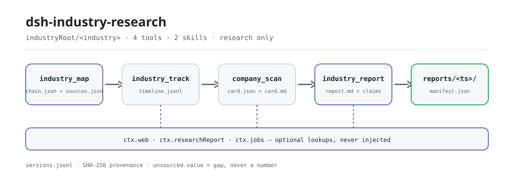

<div align="center">

<picture>
  <source media="(prefers-color-scheme: dark)" srcset="docs/assets/dsh-industry-research-flow-dark.svg">
  
</picture>

# dsh-industry-research

**Turn industry research into a checkable evidence chain — every number carries a source and a date, every gap is declared.**

An industry and company research domain pack for DeepSeek Harness: four workspace-bound tools plus two methodology skills, public sources only, research support only.

[Install](#three-step-setup) · [Configuration](#configuration) · [FAQ](#faq) · [简体中文](README.md) · [English](README.en.md) · [Español](README.es.md) · [Português](README.pt.md) · [हिन्दी](README.hi.md)

[](LICENSE)
[](#compatibility)
[](https://www.npmjs.com/package/dsh-industry-research)
[](https://github.com/PerryLink/dsh-industry-research/actions/workflows/ci.yml)
[](#compatibility)

[](https://github.com/PerryLink/dsh-industry-research/stargazers)
[](https://www.npmjs.com/package/dsh-industry-research)
[](https://dshfind.com/plugins/PerryLink/dsh-industry-research?ref=badge)
[](https://securityscorecards.dev/viewer/?uri=github.com/PerryLink/dsh-industry-research)
[](https://dsh.market/)
[](https://gitee.com/perrylink/dsh-industry-research)

```sh
dsh plugin --profile <name> add dsh-industry-research
```

</div>

<sub>A community plugin, not affiliated with DeepSeek. Sole repository: <https://github.com/PerryLink/dsh-industry-research> (Gitee is a mirror).</sub>

## What it is

`dsh-industry-research` splits industry research into a replayable pipeline: build the industry-chain map, track public-source policy and news, scan companies into cards, then assemble an auditable report. Every metric with a value must carry a `sourceRef`; every gap is an explicit slot rather than a fabricated number; a report either goes to the sealing engine or takes the builtin fallback path and says so honestly. Research support only: no trading, no price prediction, no paid or login-walled sources.

## Three-step setup

1. **Install** (pick one; both channels install the bundle row into the profile's `dsh.profile.bundles` stack and take effect on restart):

   ```sh
   # git channel (pins the commit; the first add writes an allowBuilds entry into the profile's pnpm-workspace.yaml)
   dsh plugin --profile demo add "github:PerryLink/dsh-industry-research#<sha>"
   # npm channel (published 0.3.25)
   dsh plugin --profile demo add dsh-industry-research
   ```

2. **Minimal config** (defaults are usable; override only when you need a different artifact root or offline mode):

   ```yaml
   - insert:
       - id: dsh-industry-research
         name: dsh-industry-research
         config:
           industryRoot: industry-research
           offline: false
   ```

3. **Verify it mounted**:

   ```sh
   dsh --profile demo --dump-config | grep dsh-industry-research
   ```

   Then, in a session, call the tools in order:

   ```
   Load the industry-research-method skill, then research the baijiu industry:
   build the chain with industry_map, track policy with industry_track, and finish with industry_report.
   ```

**Uninstall**: `dsh plugin --profile demo remove dsh-industry-research` (or delete the row from the profile patch).

<details>
<summary>Install from the DSH Desktop market</summary>

Every PerryLink plugin is browsable in the DSH Desktop built-in market: **Market → Sources → Add source → paste** `https://perrylink-dsh-catalog.perrylink.workers.dev/catalog-source.json` **→ select it**. Installation still goes through the market's npm identity check and your confirmation.

</details>

## Core capabilities

- **`industry_map`** — build or update an industry chain map (`chain.json`): upstream/midstream/downstream nodes, edges, and metric slots. A metric with a `value` must carry a `sourceRef`; a value-less slot is an explicit gap. Node `status` assertions carry a `statusAsOf`, and an optional `taxonomyCode` must hit the built-in national economy industry classification table. With `renderSvg: true` it also writes a deterministic, tier-layered `chain.svg` network diagram with funnel/hub bottleneck highlighting. A `depth` argument scales the web assist. Seed notes/files and an optional `ctx.web` digest are registered as citable sources (`S1`, `S2`, …).
- **`industry_track`** — public-source policy/news tracking over the official `ctx.web` seam: per-topic search, host allow/block lists, `since` filtering, bounded snapshot fetches with SHA-256 provenance hashes, and append + dedupe into `timeline.jsonl` with a retention cap. Entries may carry a validated `evidenceCategory`; a `depth` argument scales source counts. Fails loud when the web capability is unreachable.
- **`company_scan`** — company cards (`card.json` + `card.md`) from your workspace data files (SHA-256-hashed, with Markdown outlines and figure-candidate lines so every number cites a file and a line), plus an optional `ctx.web` citation complement. Cards carry a listing `status` (with `statusAsOf`), a format-checked `ticker`, and sourced price/value `metrics` (each with `source` + `asOf`). Batch mode (`companies`) isolates one bad company without aborting the batch; `depth` scales the web complement. Text formats only in v1 (no PDF).
- **`industry_report`** — one auditable report from the map + timeline + cards. Before producing, a deterministic delivery contract checks blocks, status/price assertions, and placeholder residue (fail loud, no half-assembled report). Timeline entries are grouped by `evidenceCategory`. A deterministic bull/bear synthesis lists sourced, dated values against declared gaps and data-quality findings, is embedded as the report's multi-perspective section, and is forked as a subagent job writing `perspectives-note.md` into the version ledger. With a mounted `ctx.researchReport` engine the evidence/sections/claims are sealed by its `assemble` and per-claim verdicts come back; without one, the builtin fallback writes versioned `reports/<YYYYMMDD-HHmmss>/report.md` + `manifest.json` with a SHA-256 source-traceability table and honestly labels `engine: 'builtin-fallback'`.
- **Artifact version ledger** — `industry_map` / `company_scan` / `industry_report` append to `versions.jsonl` (root-relative path + SHA-256 + timestamp + change type) on every artifact write; reads verify the hash and fail loud on mismatch.
- **Two methodology skills** — `industry-research-method` (chain decomposition, supply/demand framework, sourcing discipline, gap-declaration discipline) and `company-research-method` (company framework, public-source list, compliance wording).
- **Typed Cordis events** — `industry-research/map`, `industry-research/track`, `industry-research/report` emitted after each committed artifact.

Both methodology skills load on demand through the standard `skill` tool (`load the industry-research-method skill`).

### Tool surfaces

#### `industry_map({ industry, seed?, seedFiles?, web?, chain?, renderSvg?, depth? })`

Called with `chain`: validates (dangling edges, unsourced values, illegal tiers, duplicate ids, status/statusAsOf, unknown `taxonomyCode` — loud failure with the full issue list) and persists `chain.json`, then lists the explicit gap slots and bottleneck nodes. Called without `chain`: returns the current map, the registered sources, and an optional `ctx.web` chain-structure digest so the model can iterate. With `renderSvg: true` it also writes a deterministic `chain.svg`. `depth` (quick/standard/comprehensive) scales the web assist. Returns a `delta` summary vs the previous `research-state.json`. Emits `industry-research/map`.

#### `industry_track({ industry, topics?, since?, depth?, evidenceCategory? })`

Searches each topic through `ctx.web`, filters by the allow/block lists and `since`, fetches page snapshots (SHA-256) within the call budget, and merges into `timeline.jsonl` (dedupe by normalized URL, capped). `depth` scales the source/fetch budget; `evidenceCategory` labels every appended entry and is validated against the six-category enum. Sources whose snapshot failed are kept as citation-only entries with the reason in `note`. Returns a `delta` summary vs the previous `research-state.json`. Fails loud naming the missing capability when `ctx.web` is unmounted or `offline: true`. Emits `industry-research/track`.

#### `company_scan({ name | companies, dataFiles?, web?, status?, statusAsOf?, ticker?, metrics?, depth?, parallel? })`

Reads the workspace data files (`.md/.txt/.csv/.tsv/.json`; v1 does not parse PDF), hashes them, extracts Markdown outlines and figure-candidate lines, optionally attaches `ctx.web` citations, and persists the card. A `status` requires a non-future `statusAsOf`; a `ticker` must match a built-in format unless `scan.strictTicker: false`; every `metrics` value must carry `source` + `asOf`. `companies` (batch) isolates one bad company without aborting the batch; `parallel: true` fans each company into an independent job when `ctx.jobs` is mounted (otherwise it falls back to sequential, reported in the result `mode`). Rejected files come back with reasons; everything the card cannot establish is an explicit gap.

#### `industry_report({ industry, sections?, companies?, draft? })`

Assembles evidence (`E-chain`, `E-timeline`, `E-company-<slug>`), verifies the read artifacts against `versions.jsonl` (hash mismatch fails loud), and either validates your `draft` (sections + claims; every claim's `evidenceIds` must reference registered evidence) or builds the mechanical auto-draft (sourced metrics and recent timeline entries become claims, grouped by `evidenceCategory`). A deterministic delivery contract runs before production and fails loud on any missing block, placeholder, or unsourced/undated assertion. A deterministic adversarial machine-check always runs, and a red-team review job (`red-review-note.md`) is spawned when `ctx.jobs` is mounted (else `review: skipped(jobs unavailable)`). A deterministic bull/bear synthesis embeds a multi-perspective section in the report and forks a debate job (`perspectives-note.md`) when `ctx.jobs` is mounted. Engine path: sealed directory + `sealHash` + per-claim verdicts. Fallback path: versioned Markdown + manifest, claims honestly marked `unverified`. Emits `industry-research/report`.

### Examples

These are the plugin's real entry points; install once, then call one.

**Detailed example** — command `industry_map`, input:

~~~sh
industry_map({
  industry: "示例",
  web: false,
  chain: {
    nodes: [
      { id: "up", name: "上游原料", tier: "upstream", metrics: [{ key: "价格", value: 10, unit: "元", asOf: "2026-01-01", sourceRef: "S1" }] },
      { id: "down", name: "下游渠道", tier: "downstream", metrics: [{ key: "占比" }] }
    ],
    edges: [{ from: "up", to: "down" }]
  }
})
~~~

Output:

~~~text
行业「示例」产业链图：已校验并写入 /tmp/dsh-industry-research-test-Pxf1l8/industry-research/示例/chain.json
节点 2 / 边 1；缺口 2 项。
与上次相比：新增源 0，移除源 0，未变化证据 0。
缺口清单：节点「下游渠道」(down) 的指标「占比」待补（无来源数值）；产业链缺少 midstream 层节点
web 辅助未执行：调用方指定 web: false
~~~

*Observed from `README.md:151-153; test/map.spec.ts:44-51; src/tools/map.ts:157-163; src/chain.ts:177-194`*

**Failure branch** — input:

~~~text
{"industry":"白酒","web":false,"chain":{"industry":"白酒","nodes":[{"id":"upstream-1","name":"高粱种植","tier":"upstream","metrics":[{"key":"市场规模","value":120,"unit":"亿元"}]}],"edges":[]}}
~~~

Output:

~~~text
isError=true; error.message=chain 校验失败（1 项）：node "upstream-1" metric "市场规模" carries a value without a sourceRef — register the source or mark the slot 待补 (omit value)
~~~

*Observed from `plugins/dsh-industry-research/src/chain.ts:158-159 (rule); plugins/dsh-industry-research/src/tools/map.ts:232-234 (throw); plugins/dsh-industry-research/README.md:179 (unsourced values fail loud); exercised through plugins/dsh-industry-research/test/harness.ts`*

**Brief examples**: `industry_track` · `company_scan` · `industry_report`

### Data layout

```
<workspace>/<industryRoot>/versions.jsonl              artifact version ledger (SHA-256 + timestamp + change)
<workspace>/<industryRoot>/<industry>/research-state.json  research-state memory
<workspace>/<industryRoot>/<industry>/chain.json      industry_map
<workspace>/<industryRoot>/<industry>/chain.svg       industry_map (renderSvg: true)
<workspace>/<industryRoot>/<industry>/timeline.jsonl  industry_track
<workspace>/<industryRoot>/<industry>/sources.json    citable source registry (S1, S2, …)
<workspace>/<industryRoot>/<industry>/notes/          seed notes
<workspace>/<industryRoot>/<industry>/red-review-note.md  industry_report (red-team review, jobs)
<workspace>/<industryRoot>/<industry>/perspectives-note.md  industry_report (bull/bear debate, jobs)
<workspace>/<industryRoot>/<industry>/reports/<ts>/   industry_report (report.md + manifest.json)
<workspace>/<industryRoot>/companies/<name>/card.*    company_scan
```

## Configuration

All tunables are Schemastery `Config` fields (overridable from cordis.yml); invalid values fail the profile load loudly. Overriding by id replaces the whole row — restate every key you need. `cordis.patch.yml` documents every key inline.

Most-used keys:

| Key | Default | Description |
|---|---|---|
| `enabled` | `true` | Master switch; `false` mounts nothing. |
| `industryRoot` | `industry-research` | Artifact root, relative to the session workspace (or absolute). |
| `fetchTimeoutMs` | `20000` | Per-request timeout (ms) for `ctx.web` search/fetch calls. |
| `timelineMaxEntries` | `500` | Entries retained per industry `timeline.jsonl` (oldest dropped). |
| `sourceAllowlist` | `[]` | Host allowlist for tracked sources (empty = all hosts). |
| `sourceBlocklist` | `[]` | Host blocklist for tracked sources (wins over the allowlist). |
| `offline` | `false` | Offline mode: never touch `ctx.web`; local workspace data only. |
| `skillsDir` | _(unset)_ | Explicit skills root override; defaults to the packaged `skills/`. |

<details>
<summary>Full configuration table (13 keys)</summary>

| Key | Default | Description |
|---|---|---|
| `enabled` | `true` | Master switch; `false` mounts nothing. |
| `industryRoot` | `industry-research` | Artifact root, relative to the session workspace (or absolute). |
| `fetchTimeoutMs` | `20000` | Per-request timeout (ms) for `ctx.web` search/fetch calls. |
| `timelineMaxEntries` | `500` | Entries retained per industry `timeline.jsonl` (oldest dropped). |
| `sourceAllowlist` | `[]` | Host allowlist for tracked sources (empty = all hosts). |
| `sourceBlocklist` | `[]` | Host blocklist for tracked sources (wins over the allowlist). |
| `offline` | `false` | Offline mode: never touch `ctx.web`; local workspace data only. |
| `skillsDir` | _(unset)_ | Explicit skills root override; defaults to the packaged `skills/`. |
| `track.maxResultsPerTopic` | `10` | `web_search` maxResults per topic. |
| `track.maxFetchesPerCall` | `10` | Snapshot-fetch budget per `industry_track` call. |
| `scan.maxFileBytes` | `1048576` | Per-file read cap for company data files. |
| `scan.maxFigureCandidates` | `100` | Figure-candidate budget per company scan. |
| `scan.strictTicker` | `true` | Company-card tickers must match a built-in format (A-share 6 digits, US 1–5 letters, HK 1–5 digits); `false` exempts the format check. |

</details>

Profile patch override example:

```yaml
- insert:
    - id: dsh-industry-research
      name: dsh-industry-research
      config:
        industryRoot: industry-research
        offline: false
        track:
          maxFetchesPerCall: 5
        scan:
          strictTicker: false
```

## FAQ

<details>
<summary>Where does the data live? Can it leak out?</summary>

Every artifact lands under `<industryRoot>/` in the session workspace (default `industry-research/`): `chain.json`, `timeline.jsonl`, `sources.json`, `reports/<ts>/`, company cards, and the `versions.jsonl` ledger. The plugin makes no network requests of its own and stores no credentials; all retrieval goes through `ctx.web`, with provider selection and timeouts owned by the deployment and your config. Paid or login-walled sources are out of scope — export them yourself and pass them in as `dataFiles`.

</details>

<details>
<summary>What happens without `ctx.web` or `ctx.researchReport`? Silent failure?</summary>

Never silent. Without `ctx.web`, `industry_track` fails loud naming the missing capability; without `ctx.researchReport`, `industry_report` takes the builtin fallback and writes a versioned `report.md` + `manifest.json` honestly labelled `engine: 'builtin-fallback'` with claims marked `unverified`. Without `ctx.jobs`, `parallel: true` degrades to sequential and the red-team review and bull/bear debate are reported as `skipped(jobs unavailable)`.

</details>

<details>
<summary>Will it conflict with other plugins?</summary>

No. It injects only `skills` and `tools`; it registers no waterfall listener, command, client slot, or `webServer` route, and looks up `ctx.web` / `ctx.researchReport` / `ctx.jobs` with `ctx.get(...)` at execution time instead of injecting them, so a missing sibling never parks the plugin tree in PENDING. See "Interoperability" for the per-item evidence.

</details>

<details>
<summary>What is the performance cost?</summary>

All of it is local deterministic work: reading and writing Markdown/JSON, hashing with SHA-256, validating structures — no model calls. Network activity happens only in `industry_track` (and the web assist of `industry_map` / `company_scan`) and is bounded as a foreground budget by `track.maxFetchesPerCall`, `track.maxResultsPerTopic`, and `fetchTimeoutMs`; `offline: true` turns networking off entirely.

</details>

<details>
<summary>Can it read PDFs directly?</summary>

No. v1 reads text formats only (`.md/.txt/.csv/.tsv/.json`) and does not parse PDF. Convert the PDF to text or Markdown first, then pass it as `dataFiles`.

</details>

## Security boundaries

- **Workspace containment** — industry/company names are validated path segments; data files are containment-checked against the session cwd (both sides resolved).
- **Provenance by construction** — sources carry SHA-256 hashes; unsourced numbers are validation errors; corrupt timeline lines are skipped with a surfaced count, never silently.
- **Honest degradation** — missing `ctx.web` / `ctx.researchReport` produce loud failures or honestly labeled fallback artifacts, never silent fabrication.
- **Reversible registrations** — everything goes through `ctx.effect()` / `ctx.on()` / `register()`.
- **Research-only compliance** — tool descriptions, cards, and reports carry "research only, not investment advice"; data points carry asOf and sources.

## Known limitations

- **Cordis events, not session-log events** — `industry-research/*` events are typed Cordis observability events and are never appended to the session log; the durable record is the workspace artifacts themselves, and model-visible tool results ride the durable `tool/result` session event.
- **No `ctx.attachment` writes** — the rc2 attachment seam accepts images only (PNG/JPEG/WebP/GIF); Markdown reports therefore stay versioned workspace files, referenced by absolute path in the tool result.
- **v1 reads text formats only** — no PDF parsing; ask users to convert PDFs to text/Markdown first.
- **Chinese-edition skills** — the packaged methodology skills ship in Chinese; an English edition is future work.
- **Foreground tools** — `industry_track` is bounded by `track.maxFetchesPerCall` and `fetchTimeoutMs` and runs in the foreground; a background-jobs mode is future work.
- **The auto-draft is mechanical** — it summarizes artifacts and turns sourced data points into claims; narrative quality comes from model-authored `draft`s.

## Interoperability

The plugin consumes public seams only and takes over no shared resource:

- **Two injected services only** — `inject = ['skills', 'tools']`; `ctx.web`, `ctx.researchReport`, and `ctx.jobs` are all execution-time `ctx.get(...)` structural lookups (with shape guards), so a missing one never leaves the plugin in PENDING.
- **No listeners** — there is no waterfall listener and no subscription to shared events such as `agent/pre-step` or `tools/post-execute`, so it cannot short-circuit or starve another plugin.
- **No shared-name grabs** — it registers no command, client slot, or `webServer` prefix; the four tool names (`industry_map`, `industry_track`, `company_scan`, `industry_report`) are namespaced and take no bare name.
- **Skills use a dedicated provider** — mounted as `industry-research` with `includeDefaultRoots: false`, so it neither takes over nor replaces the global skills root; an invalid `skillsDir` fails loud at load.
- **The patch only inserts itself** — the bundle patch inserts its own row and never overwrites a built-in row's `config`.
- **The `dsh-research-report` contract is type-side** — `AssembleReportRequest` and friends come in as type-only devDependency imports erased at build time; at runtime only `ctx.get('researchReport')` is looked up, and without it the builtin fallback runs — sealed results are never invented.
- **With `dsh-base`** — `ctx.web` is composed by the base bundle; when missing, `industry_track` fails loud with mount guidance.
- **Continuous check-ups** — `.github/workflows/plugin-doctor.yml` runs the plugin doctor; the verdicts are whatever that workflow reports.

## Permissions & data

`dsh-industry-research` consumes only public seams: `ctx.tools`, `ctx.skills`, and — looked up optionally — `ctx.web` and `ctx.researchReport`. It performs no network access of its own (all retrieval goes through `ctx.web` with the deployment's provider selection and your configured timeouts), stores no credentials, and writes only inside the session workspace under `industryRoot`. Only public sources are used; paid or login-walled sources are out of scope — pass your own exports in as `dataFiles`.

## Compatibility

| Dimension | Status |
|---|---|
| Harness | DeepSeek Harness `dsh-v0.2.1-alpha.1` (published npm line, verified 2026-09-25); `package.json` declares `engine.dsh` `>=0.2.1-0 <0.3.0 \|\| >=0.2.2-0 <0.3.0`. 0.1.2-rc.1 (adapted 2026-09-02): the session envelope keeps its ignorable field for stored-log read compatibility only — Session.append still cannot stamp it, so audit-gate behavior is unchanged. Verified 2026-09-24 against the `0.1.7-rc.2` published peers (full gate chain; the real profile install smoke runs in the weekly and per-PR `compat.yml` job). |
| Node | `^22.19.0 \|\| >=24.9.0`, ESM only (`"type": "module"`). |
| Peer dependencies | `@deepseek-ai/cordis ^4.0.5-alpha.1`, `@deepseek-ai/schemastery ^3.18.5-alpha.1`, and `@deepseek-ai/dsh-tools`, `@deepseek-ai/dsh-skill`, `@deepseek-ai/dsh-skill-filesystem` (peer range `>=0.1.2-rc.1 <0.2.0 \|\| >=0.1.5-alpha.1 <0.2.0 \|\| >=0.1.6-0 <0.2.0 \|\| >=0.1.7-0 <0.2.0 \|\| >=0.2.0-0 <0.3.0 \|\| >=0.2.1-0 <0.3.0 \|\| >=0.2.2-0 <0.3.0`; all composed by the official `dsh-base` bundle). |
| Platform | Anywhere DSH runs; the tools are pure host-side TypeScript with no browser half. |
| Optional capabilities | Looked up at execution time (never injected): `ctx.web` (public-source retrieval — composed by `dsh-base`) and `ctx.researchReport` (the sibling `dsh-research-report` sealing engine). |

## Ecosystem & quality

- [Gitee mirror](https://gitee.com/perrylink/dsh-industry-research) (synced mirror; GitHub is canonical)
- [dshfind plugin page](https://dshfind.com/plugins/PerryLink/dsh-industry-research) (installs and ranking)
- [OpenSSF Scorecard report](https://securityscorecards.dev/viewer/?uri=github.com/PerryLink/dsh-industry-research) (driven by [.github/workflows/scorecard.yml](.github/workflows/scorecard.yml))
- [dsh-plugin-doctor verification report](https://github.com/PerryLink/dsh-plugin-doctor#verified-徽章)
- [DSH Market](https://dsh.market/) (listed)
- **1024 store channel**: run `npm i -g dsh1024` once, then `dsh1024 plugin --profile web add dsh-industry-research` (counts toward the [deepseek1024.com](https://deepseek1024.com) install ranking)
- [Ecosystem knowledge base](https://perrylink.github.io/dsh-plugin-guide/) (measured data, not marketing): plugin development guide · plugin-selection data · maintenance criteria

## Development

```sh
pnpm install
pnpm run typecheck && pnpm run typecheck:ci     # published-peer face + the published line with skipLibCheck cleared
pnpm test                                       # vitest
pnpm run build                                  # scripts/prepare.mjs → lib/
pnpm run verify:self-contained && pnpm run verify:artifacts
pnpm run verify:readme-sync                     # five-language README structure and config-key parity
pnpm run verify:skills                          # skills frontmatter gate
pnpm run pack:check
```

Images are generated by [`scripts/gen-readme-assets.py`](scripts/gen-readme-assets.py) (Python + Pillow) and can be re-run: `python scripts/gen-readme-assets.py`. Both light and dark SVGs live in `docs/assets/`; the visible text is command/artifact tokens only, so all five languages share them.

| Path | Contents |
|---|---|
| `src/` | Function-plugin entry (`index.ts`), `config.ts`, the four tools, and the pure data models |
| `skills/` | The two Chinese-edition methodology skills (`SKILL.md` bundles) |
| `cordis.patch.yml` | Bundle row declaration with every key documented inline |
| `test/` | vitest suite (real Context / ToolRuntime / SkillRegistry / WebRuntime) |
| `fixtures/` | Baijiu teaching fixtures (fictional, clearly marked) |
| `scripts/` | Build and gates: `prepare.mjs`, `verify-*`, `check-readme-sync.mjs`, `check-skills.mjs` |
| `docs/assets/` | README images (generated by this script) |
| `.github/workflows/` | CI, compat, plugin-doctor, release, scorecard |

Topics: `dsh`, `dsh-plugin`, `deepseek-harness`, `cordis`, `industry-research`, `company-research`, `research`, `report`

## Family & acknowledgements

This project is part of the DeepSeek Harness plugin family maintained by [PerryLink](https://github.com/PerryLink) (all Apache-2.0). If it is useful, **a star helps the next person find it** — nothing is gated behind it.

- Initial design and implementation by the `dsh-industry-research` development session (DeepSeek Harness).
- External contributions are welcome — open an issue or a pull request.

<details>
<summary>Expand all plugins</summary>

| Plugin | Status |
|---|---|
| **[dsh-aqua-input-check](https://github.com/PerryLink/dsh-aqua-input-check)** |  |
| **[dsh-archive-check](https://github.com/PerryLink/dsh-archive-check)** |  |
| **[dsh-auto-review](https://github.com/PerryLink/dsh-auto-review)** |  |
| **[dsh-autotier](https://github.com/PerryLink/dsh-autotier)** | 🧊 FROZEN — see the repo README |
| **[dsh-bid-ca-precheck](https://github.com/PerryLink/dsh-bid-ca-precheck)** |  |
| **[dsh-bid-qual-check](https://github.com/PerryLink/dsh-bid-qual-check)** |  |
| **[dsh-cert-mcp](https://github.com/PerryLink/dsh-cert-mcp)** | 🧊 FROZEN — see the repo README |
| **[dsh-checkpoint-rewind](https://github.com/PerryLink/dsh-checkpoint-rewind)** |  |
| **[dsh-click](https://github.com/PerryLink/dsh-click)** |  |
| **[dsh-composer-history](https://github.com/PerryLink/dsh-composer-history)** |  |
| **[dsh-contract-stance](https://github.com/PerryLink/dsh-contract-stance)** |  |
| **[dsh-customs-doc-check](https://github.com/PerryLink/dsh-customs-doc-check)** |  |
| **[dsh-data-quality](https://github.com/PerryLink/dsh-data-quality)** | 🧊 FROZEN — see the repo README |
| **[dsh-demurrage-ledger](https://github.com/PerryLink/dsh-demurrage-ledger)** |  |
| **[dsh-doublecheck](https://github.com/PerryLink/dsh-doublecheck)** |  |
| **[dsh-drill-script-check](https://github.com/PerryLink/dsh-drill-script-check)** |  |
| **[dsh-eia-guide-check](https://github.com/PerryLink/dsh-eia-guide-check)** |  |
| **[dsh-emergency-plan](https://github.com/PerryLink/dsh-emergency-plan)** |  |
| **[dsh-essay-rubric-check](https://github.com/PerryLink/dsh-essay-rubric-check)** |  |
| **[dsh-evidence-check](https://github.com/PerryLink/dsh-evidence-check)** |  |
| **[dsh-export-ctl-check](https://github.com/PerryLink/dsh-export-ctl-check)** |  |
| **[dsh-fast](https://github.com/PerryLink/dsh-fast)** |  |
| **[dsh-fmea-table-check](https://github.com/PerryLink/dsh-fmea-table-check)** |  |
| **[dsh-forecast-penalty](https://github.com/PerryLink/dsh-forecast-penalty)** |  |
| **[dsh-fund-research](https://github.com/PerryLink/dsh-fund-research)** |  |
| **[dsh-github](https://github.com/PerryLink/dsh-github)** |  |
| **[dsh-gongwen-flow-check](https://github.com/PerryLink/dsh-gongwen-flow-check)** |  |
| **[dsh-gongwen-word-check](https://github.com/PerryLink/dsh-gongwen-word-check)** |  |
| **[dsh-guard-plan-qc](https://github.com/PerryLink/dsh-guard-plan-qc)** |  |
| **[dsh-hazchem-check](https://github.com/PerryLink/dsh-hazchem-check)** |  |
| **[dsh-hazplan-check](https://github.com/PerryLink/dsh-hazplan-check)** |  |
| **[dsh-hidden-risk-map](https://github.com/PerryLink/dsh-hidden-risk-map)** |  |
| **[dsh-hs-classify](https://github.com/PerryLink/dsh-hs-classify)** |  |
| **[dsh-icd-rule-check](https://github.com/PerryLink/dsh-icd-rule-check)** |  |
| **[dsh-industry-research](https://github.com/PerryLink/dsh-industry-research)** |  |
| **[dsh-lawcite-adapter](https://github.com/PerryLink/dsh-lawcite-adapter)** |  |
| **[dsh-laya](https://github.com/PerryLink/dsh-laya)** |  |
| **[dsh-lc-doc-check](https://github.com/PerryLink/dsh-lc-doc-check)** |  |
| **[dsh-learning-gap-check](https://github.com/PerryLink/dsh-learning-gap-check)** |  |
| **[dsh-library](https://github.com/PerryLink/dsh-library)** |  |
| **[dsh-local-ai](https://github.com/PerryLink/dsh-local-ai)** |  |
| **[dsh-lsp-actions](https://github.com/PerryLink/dsh-lsp-actions)** |  |
| **[dsh-mask](https://github.com/PerryLink/dsh-mask)** |  |
| **[dsh-mcp-panel](https://github.com/PerryLink/dsh-mcp-panel)** |  |
| **[dsh-medrec-qc](https://github.com/PerryLink/dsh-medrec-qc)** |  |
| **[dsh-memento](https://github.com/PerryLink/dsh-memento)** | 🧊 FROZEN — see the repo README |
| **[dsh-nsfc-form-check](https://github.com/PerryLink/dsh-nsfc-form-check)** |  |
| **[dsh-nurse-record-check](https://github.com/PerryLink/dsh-nurse-record-check)** |  |
| **[dsh-observe](https://github.com/PerryLink/dsh-observe)** |  |
| **[dsh-origin-rvc-check](https://github.com/PerryLink/dsh-origin-rvc-check)** |  |
| **[dsh-ota-review-check](https://github.com/PerryLink/dsh-ota-review-check)** |  |
| **[dsh-output-styles](https://github.com/PerryLink/dsh-output-styles)** |  |
| **[dsh-paper-doc-adapter](https://github.com/PerryLink/dsh-paper-doc-adapter)** |  |
| **[dsh-permission-rules](https://github.com/PerryLink/dsh-permission-rules)** |  |
| **[dsh-permit-report-check](https://github.com/PerryLink/dsh-permit-report-check)** |  |
| **[dsh-pipeline-check](https://github.com/PerryLink/dsh-pipeline-check)** |  |
| **[dsh-pleading-draft](https://github.com/PerryLink/dsh-pleading-draft)** |  |
| **[dsh-plugin-doctor](https://github.com/PerryLink/dsh-plugin-doctor)** | 🚫 RETIRED (repo archived) |
| **[dsh-plugin-guide](https://github.com/PerryLink/dsh-plugin-guide)** |  |
| **[dsh-plugin-kit](https://github.com/PerryLink/dsh-plugin-kit)** | 🚫 RETIRED (repo archived) |
| **[dsh-plugin-upgrade](https://github.com/PerryLink/dsh-plugin-upgrade)** | 🚫 RETIRED (repo archived) |
| **[dsh-policy-brief-draft](https://github.com/PerryLink/dsh-policy-brief-draft)** |  |
| **[dsh-power-loss-split](https://github.com/PerryLink/dsh-power-loss-split)** |  |
| **[dsh-power-ticket-check](https://github.com/PerryLink/dsh-power-ticket-check)** |  |
| **[dsh-ppap-check](https://github.com/PerryLink/dsh-ppap-check)** |  |
| **[dsh-protest-deadline](https://github.com/PerryLink/dsh-protest-deadline)** |  |
| **[dsh-railway-window](https://github.com/PerryLink/dsh-railway-window)** |  |
| **[dsh-repair-order-qc](https://github.com/PerryLink/dsh-repair-order-qc)** |  |
| **[dsh-research-report](https://github.com/PerryLink/dsh-research-report)** |  |
| **[dsh-review-reply-check](https://github.com/PerryLink/dsh-review-reply-check)** |  |
| **[dsh-rulefile-check](https://github.com/PerryLink/dsh-rulefile-check)** |  |
| **[dsh-safety-brief-check](https://github.com/PerryLink/dsh-safety-brief-check)** |  |
| **[dsh-score](https://github.com/PerryLink/dsh-score)** | 🧊 FROZEN — see the repo README |
| **[dsh-session-sync](https://github.com/PerryLink/dsh-session-sync)** |  |
| **[dsh-site-log-check](https://github.com/PerryLink/dsh-site-log-check)** |  |
| **[dsh-skill-pack-security](https://github.com/PerryLink/dsh-skill-pack-security)** |  |
| **[dsh-soe-decision-check](https://github.com/PerryLink/dsh-soe-decision-check)** |  |
| **[dsh-soilwater-check](https://github.com/PerryLink/dsh-soilwater-check)** |  |
| **[dsh-sop-sync-check](https://github.com/PerryLink/dsh-sop-sync-check)** |  |
| **[dsh-spc-gbt-adapter](https://github.com/PerryLink/dsh-spc-gbt-adapter)** |  |
| **[dsh-talk](https://github.com/PerryLink/dsh-talk)** |  |
| **[dsh-tender-extract](https://github.com/PerryLink/dsh-tender-extract)** |  |
| **[dsh-tender-matrix](https://github.com/PerryLink/dsh-tender-matrix)** |  |
| **[dsh-test-drive](https://github.com/PerryLink/dsh-test-drive)** |  |
| **[dsh-ticktick](https://github.com/PerryLink/dsh-ticktick)** | 🚫 RETIRED (repo archived) |
| **[dsh-translate](https://github.com/PerryLink/dsh-translate)** |  |
| **[dsh-warranty-calc](https://github.com/PerryLink/dsh-warranty-calc)** |  |
| **[dsh-budget](https://github.com/PerryLink/dsh-budget)** | 🧊 FROZEN — see the repo README |
| **[dsh-claude-move](https://github.com/PerryLink/dsh-claude-move)** | 🧊 FROZEN — see the repo README |
| **[dsh-defend](https://github.com/PerryLink/dsh-defend)** | 🧊 FROZEN — see the repo README |
| **[dsh-draw](https://github.com/PerryLink/dsh-draw)** | 🧊 FROZEN — see the repo README |
| **[dsh-reach](https://github.com/PerryLink/dsh-reach)** | 🧊 FROZEN — see the repo README |
| **[dsh-background-agents](https://github.com/PerryLink/dsh-background-agents)** | 🚫 RETIRED (repo archived) |
| **[dsh-session-pin](https://github.com/PerryLink/dsh-session-pin)** | 🚫 RETIRED (repo archived) |
| **[dsh-team-rooms](https://github.com/PerryLink/dsh-team-rooms)** | 🚫 RETIRED (repo archived) |

</details>

## License

Apache-2.0 — see [LICENSE](LICENSE).

<p align="center"><sub>Apache-2.0 · a community plugin, not affiliated with DeepSeek.</sub></p>
