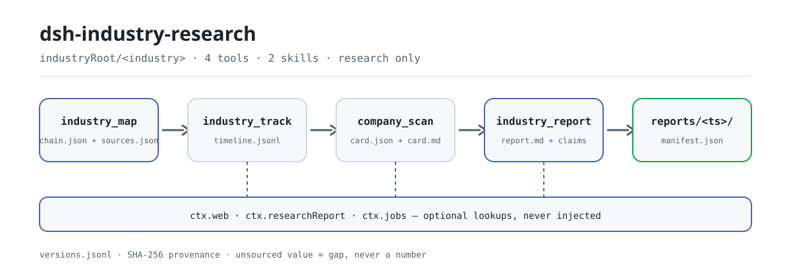

<div align="center">

<picture>
  <source media="(prefers-color-scheme: dark)" srcset="docs/assets/dsh-industry-research-flow-dark.svg">
  
</picture>

# dsh-industry-research

**Convierte una investigación sectorial en una cadena de evidencia verificable: cada cifra lleva fuente y fecha, cada hueco se declara.**

Un paquete de dominio de investigación sectorial y empresarial para DeepSeek Harness: cuatro herramientas ligadas al workspace y dos skills metodológicos, solo fuentes públicas y solo apoyo a la investigación.

[Instalación](#instalación-en-tres-pasos) · [Configuración](#configuración) · [FAQ](#faq) · [简体中文](README.md) · [English](README.en.md) · [Español](README.es.md) · [Português](README.pt.md) · [हिन्दी](README.hi.md)

[](LICENSE)
[](#compatibilidad)
[](https://www.npmjs.com/package/dsh-industry-research)
[](https://github.com/PerryLink/dsh-industry-research/actions/workflows/ci.yml)
[](#compatibilidad)

[](https://github.com/PerryLink/dsh-industry-research/stargazers)
[](https://www.npmjs.com/package/dsh-industry-research)
[](https://dshfind.com/plugins/PerryLink/dsh-industry-research?ref=badge)
[](https://securityscorecards.dev/viewer/?uri=github.com/PerryLink/dsh-industry-research)
[](https://dsh.market/)
[](https://gitee.com/perrylink/dsh-industry-research)

```sh
dsh plugin --profile <name> add dsh-industry-research
```

</div>

<sub>Plugin de la comunidad, no afiliado a DeepSeek. Repositorio único: <https://github.com/PerryLink/dsh-industry-research> (Gitee es un espejo).</sub>

## Qué es

`dsh-industry-research` divide la investigación sectorial en una tubería reproducible: construir el mapa de la cadena industrial, seguir políticas y noticias de fuentes públicas, escanear empresas en fichas y, por último, ensamblar un informe auditable. Toda métrica con valor debe llevar un `sourceRef`; todo hueco es una ranura explícita y no una cifra inventada; el informe se entrega al motor de sellado o toma la ruta de respaldo integrada y lo declara con honestidad. Solo apoyo a la investigación: sin trading, sin predicción de precios y sin fuentes de pago o con muro de acceso.

## Instalación en tres pasos

1. **Instalar** (elige una vía; ambas montan la fila del bundle en la pila `dsh.profile.bundles` del perfil y surten efecto al reiniciar):

   ```sh
   # vía git (fija el commit; el primer add escribe una entrada allowBuilds en el pnpm-workspace.yaml del perfil)
   dsh plugin --profile demo add "github:PerryLink/dsh-industry-research#<sha>"
   # vía npm (publicado 0.3.25)
   dsh plugin --profile demo add dsh-industry-research
   ```

2. **Configuración mínima** (los valores por defecto ya sirven; solo hay que sobrescribir si cambias la raíz de artefactos o el modo offline):

   ```yaml
   - insert:
       - id: dsh-industry-research
         name: dsh-industry-research
         config:
           industryRoot: industry-research
           offline: false
   ```

3. **Verificar que quedó montado**:

   ```sh
   dsh --profile demo --dump-config | grep dsh-industry-research
   ```

   Después, en una sesión, llama las herramientas en orden:

   ```
   Carga el skill industry-research-method y luego investiga la industria del baijiu:
   construye la cadena con industry_map, sigue la política con industry_track y termina con industry_report.
   ```

**Desinstalar**: `dsh plugin --profile demo remove dsh-industry-research` (o borra la fila del patch del perfil).

<details>
<summary>Instalar desde el mercado de DSH Desktop</summary>

Todos los plugins de PerryLink se pueden explorar en el mercado integrado de DSH Desktop: **Market → Sources → Add source → pega** `https://perrylink-dsh-catalog.perrylink.workers.dev/catalog-source.json` **→ selecciónalo**. La instalación sigue pasando por la verificación de identidad npm del mercado y tu confirmación.

</details>

## Capacidades clave

- **`industry_map`** — construye o actualiza el mapa de la cadena industrial (`chain.json`): nodos upstream/midstream/downstream, aristas y ranuras de métricas. Una métrica con `value` debe llevar `sourceRef`; una ranura sin valor es un hueco explícito. Las afirmaciones de `status` de un nodo llevan `statusAsOf`, y un `taxonomyCode` opcional debe coincidir con la tabla integrada de clasificación nacional de industrias. Con `renderSvg: true` escribe además un `chain.svg` determinista, por capas, con resaltado de cuellos de botella tipo embudo/hub. El argumento `depth` escala la ayuda web. Las notas/archivos semilla y un resumen opcional de `ctx.web` se registran como fuentes citables (`S1`, `S2`, …).
- **`industry_track`** — seguimiento de políticas y noticias de fuentes públicas por la costura oficial `ctx.web`: búsqueda por tema, listas blancas/negras de hosts, filtro `since`, capturas acotadas con hash de procedencia SHA-256 y anexado con deduplicación en `timeline.jsonl` (con tope de retención). Las entradas pueden llevar un `evidenceCategory` validado; `depth` escala el número de fuentes. Falla en voz alta cuando la capacidad web no está disponible.
- **`company_scan`** — fichas de empresa (`card.json` + `card.md`) a partir de archivos de datos del workspace (hash SHA-256, esquemas Markdown y líneas candidatas a cifra para que cada número cite archivo y línea), más un complemento opcional de citas de `ctx.web`. Las fichas llevan `status` de cotización (con `statusAsOf`), `ticker` validado por formato y `metrics` con fuente y `asOf`. El modo lote (`companies`) aísla una empresa defectuosa sin abortar el lote; `depth` escala el complemento web. En v1 solo formatos de texto (sin PDF).
- **`industry_report`** — un informe auditable a partir del mapa + línea de tiempo + fichas. Antes de producir, un contrato de entrega determinista revisa bloques, afirmaciones de estado/precio y restos de plantilla (falla en voz alta, nunca un informe a medio armar). Las entradas de la línea de tiempo se agrupan por `evidenceCategory`. Una síntesis determinista bull/bear enumera los valores con fuente y fecha frente a los huecos declarados y hallazgos de calidad de datos, se incrusta como sección multiperspectiva del informe y se bifurca como job de subagente que escribe `perspectives-note.md` en el libro de versiones. Con un motor `ctx.researchReport` montado, la evidencia/secciones/claims se sellan con su `assemble` y vuelven los veredictos por claim; sin él, la ruta de respaldo integrada escribe `reports/<YYYYMMDD-HHmmss>/report.md` + `manifest.json` versionados con tabla de trazabilidad SHA-256 y etiqueta honestamente `engine: 'builtin-fallback'`.
- **Libro de versiones de artefactos** — `industry_map` / `company_scan` / `industry_report` añaden una entrada a `versions.jsonl` (ruta relativa a la raíz + SHA-256 + marca de tiempo + tipo de cambio) en cada escritura; las lecturas verifican el hash y fallan en voz alta si no coincide.
- **Dos skills de metodología** — `industry-research-method` (descomposición de la cadena, marco de oferta/demanda, disciplina de fuentes y de declaración de huecos) y `company-research-method` (marco de empresa, lista de fuentes públicas, redacción de cumplimiento).
- **Eventos Cordis tipados** — `industry-research/map`, `industry-research/track` e `industry-research/report` se emiten tras cada artefacto confirmado.

Ambos skills de metodología se cargan bajo demanda con la herramienta estándar `skill` (`carga el skill industry-research-method`).

### Superficies de las herramientas

#### `industry_map({ industry, seed?, seedFiles?, web?, chain?, renderSvg?, depth? })`

Llamada con `chain`: valida (aristas colgantes, valores sin fuente, tiers ilegales, ids duplicados, status/statusAsOf, `taxonomyCode` desconocido — falla en voz alta con la lista completa de problemas) y persiste `chain.json`, luego enumera las ranuras de hueco explícitas y los nodos cuello de botella. Sin `chain`: devuelve el mapa actual, las fuentes registradas y un resumen opcional de estructura de cadena vía `ctx.web` para que el modelo itere. Con `renderSvg: true` escribe además un `chain.svg` determinista. `depth` (quick/standard/comprehensive) escala la ayuda web. Devuelve un resumen `delta` frente al `research-state.json` anterior. Emite `industry-research/map`.

#### `industry_track({ industry, topics?, since?, depth?, evidenceCategory? })`

Busca cada tema por `ctx.web`, filtra por listas blancas/negras y `since`, captura instantáneas de página (SHA-256) dentro del presupuesto de la llamada y las fusiona en `timeline.jsonl` (deduplicación por URL normalizada, con tope). `depth` escala el presupuesto de fuentes/capturas; `evidenceCategory` etiqueta cada entrada añadida y se valida contra el enum de seis categorías. Las fuentes cuya captura falló se conservan como entradas de solo cita con el motivo en `note`. Devuelve un resumen `delta` frente al `research-state.json` anterior. Falla en voz alta nombrando la capacidad faltante cuando `ctx.web` no está montado u `offline: true`. Emite `industry-research/track`.

#### `company_scan({ name | companies, dataFiles?, web?, status?, statusAsOf?, ticker?, metrics?, depth?, parallel? })`

Lee los archivos de datos del workspace (`.md/.txt/.csv/.tsv/.json`; v1 no parsea PDF), los hashea, extrae esquemas Markdown y líneas candidatas a cifra, adjunta opcionalmente citas de `ctx.web` y persiste la ficha. Un `status` exige un `statusAsOf` no futuro; un `ticker` debe coincidir con un formato integrado salvo `scan.strictTicker: false`; cada valor de `metrics` debe llevar `source` + `asOf`. `companies` (lote) aísla una empresa defectuosa sin abortar el lote; `parallel: true` reparte cada empresa en un job independiente cuando `ctx.jobs` está montado (si no, cae a secuencial y lo informa en `mode`). Los archivos rechazados vuelven con motivo; todo lo que la ficha no puede establecer es un hueco explícito.

#### `industry_report({ industry, sections?, companies?, draft? })`

Ensambla la evidencia (`E-chain`, `E-timeline`, `E-company-<slug>`), verifica los artefactos leídos contra `versions.jsonl` (hash distinto falla en voz alta) y valida tu `draft` (secciones + claims; los `evidenceIds` de cada claim deben referenciar evidencia registrada) o construye el borrador automático mecánico (métricas con fuente y entradas recientes de la línea de tiempo se vuelven claims, agrupadas por `evidenceCategory`). Antes de producir corre un contrato de entrega determinista que falla en voz alta ante cualquier bloque faltante, plantilla residual o afirmación sin fuente o sin fecha. La comprobación adversaria determinista siempre corre, y se lanza un job de revisión red-team (`red-review-note.md`) cuando `ctx.jobs` está montado (si no, `review: skipped(jobs unavailable)`). Una síntesis determinista bull/bear incrusta una sección multiperspectiva y bifurca un job de debate (`perspectives-note.md`) cuando `ctx.jobs` está montado. Ruta con motor: directorio sellado + `sealHash` + veredictos por claim. Ruta de respaldo: Markdown versionado + manifest, con los claims marcados honestamente como `unverified`. Emite `industry-research/report`.

### Ejemplos

Estos son los puntos de entrada reales del plugin; instala una vez y llama uno.

**Ejemplo detallado** — comando `industry_map`, entrada:

~~~sh
industry_map({
  industry: "示例",
  web: false,
  chain: {
    nodes: [
      { id: "up", name: "上游原料", tier: "upstream", metrics: [{ key: "价格", value: 10, unit: "元", asOf: "2026-01-01", sourceRef: "S1" }] },
      { id: "down", name: "下游渠道", tier: "downstream", metrics: [{ key: "占比" }] }
    ],
    edges: [{ from: "up", to: "down" }]
  }
})
~~~

Salida:

~~~text
行业「示例」产业链图：已校验并写入 /tmp/dsh-industry-research-test-Pxf1l8/industry-research/示例/chain.json
节点 2 / 边 1；缺口 2 项。
与上次相比：新增源 0，移除源 0，未变化证据 0。
缺口清单：节点「下游渠道」(down) 的指标「占比」待补（无来源数值）；产业链缺少 midstream 层节点
web 辅助未执行：调用方指定 web: false
~~~

*Observed from `README.md:151-153; test/map.spec.ts:44-51; src/tools/map.ts:157-163; src/chain.ts:177-194`*

**Rama de fallo** — entrada:

~~~text
{"industry":"白酒","web":false,"chain":{"industry":"白酒","nodes":[{"id":"upstream-1","name":"高粱种植","tier":"upstream","metrics":[{"key":"市场规模","value":120,"unit":"亿元"}]}],"edges":[]}}
~~~

Salida:

~~~text
isError=true; error.message=chain 校验失败（1 项）：node "upstream-1" metric "市场规模" carries a value without a sourceRef — register the source or mark the slot 待补 (omit value)
~~~

*Observed from `plugins/dsh-industry-research/src/chain.ts:158-159 (rule); plugins/dsh-industry-research/src/tools/map.ts:232-234 (throw); plugins/dsh-industry-research/README.md:179 (unsourced values fail loud); exercised through plugins/dsh-industry-research/test/harness.ts`*

**Ejemplos breves**: `industry_track` · `company_scan` · `industry_report`

### Disposición de datos

```
<workspace>/<industryRoot>/versions.jsonl              libro de versiones de artefactos (SHA-256 + marca de tiempo + cambio)
<workspace>/<industryRoot>/<industria>/research-state.json  memoria de estado de investigación
<workspace>/<industryRoot>/<industria>/chain.json      industry_map
<workspace>/<industryRoot>/<industria>/chain.svg       industry_map (renderSvg: true)
<workspace>/<industryRoot>/<industria>/timeline.jsonl  industry_track
<workspace>/<industryRoot>/<industria>/sources.json    registro de fuentes citables (S1, S2, …)
<workspace>/<industryRoot>/<industria>/notes/          notas semilla
<workspace>/<industryRoot>/<industria>/red-review-note.md  industry_report (revisión red-team, jobs)
<workspace>/<industryRoot>/<industria>/perspectives-note.md  industry_report (debate bull/bear, jobs)
<workspace>/<industryRoot>/<industria>/reports/<ts>/   industry_report (report.md + manifest.json)
<workspace>/<industryRoot>/companies/<empresa>/card.*  company_scan
```

## Configuración

Todas las opciones son campos `Config` de Schemastery (sobrescribibles desde cordis.yml); un valor inválido hace fallar la carga del perfil en voz alta. Sobrescribir por id reemplaza la fila completa: vuelve a declarar todas las claves que necesites. `cordis.patch.yml` documenta cada clave en línea.

Claves más usadas:

| Clave | Valor por defecto | Descripción |
|---|---|---|
| `enabled` | `true` | Interruptor maestro; `false` no monta nada. |
| `industryRoot` | `industry-research` | Raíz de artefactos, relativa al workspace de la sesión (o absoluta). |
| `fetchTimeoutMs` | `20000` | Timeout por petición (ms) para búsqueda/captura de `ctx.web`. |
| `timelineMaxEntries` | `500` | Entradas retenidas por `timeline.jsonl` de cada industria (las más viejas se descartan). |
| `sourceAllowlist` | `[]` | Lista blanca de hosts para fuentes seguidas (vacía = todos). |
| `sourceBlocklist` | `[]` | Lista negra de hosts para fuentes seguidas (tiene prioridad sobre la blanca). |
| `offline` | `false` | Modo offline: nunca toca `ctx.web`; solo datos locales del workspace. |
| `skillsDir` | _(sin definir)_ | Raíz explícita de skills; por defecto, el `skills/` empaquetado. |

<details>
<summary>Tabla completa de configuración (13 claves)</summary>

| Clave | Valor por defecto | Descripción |
|---|---|---|
| `enabled` | `true` | Interruptor maestro; `false` no monta nada. |
| `industryRoot` | `industry-research` | Raíz de artefactos, relativa al workspace de la sesión (o absoluta). |
| `fetchTimeoutMs` | `20000` | Timeout por petición (ms) para búsqueda/captura de `ctx.web`. |
| `timelineMaxEntries` | `500` | Entradas retenidas por `timeline.jsonl` de cada industria (las más viejas se descartan). |
| `sourceAllowlist` | `[]` | Lista blanca de hosts para fuentes seguidas (vacía = todos). |
| `sourceBlocklist` | `[]` | Lista negra de hosts para fuentes seguidas (tiene prioridad sobre la blanca). |
| `offline` | `false` | Modo offline: nunca toca `ctx.web`; solo datos locales del workspace. |
| `skillsDir` | _(sin definir)_ | Raíz explícita de skills; por defecto, el `skills/` empaquetado. |
| `track.maxResultsPerTopic` | `10` | `web_search` maxResults por tema. |
| `track.maxFetchesPerCall` | `10` | Presupuesto de capturas por llamada a `industry_track`. |
| `scan.maxFileBytes` | `1048576` | Tope de lectura por archivo de datos de empresa. |
| `scan.maxFigureCandidates` | `100` | Presupuesto de líneas candidatas a cifra por escaneo de empresa. |
| `scan.strictTicker` | `true` | El ticker de la ficha debe coincidir con un formato integrado (A-share 6 dígitos, EE. UU. 1–5 letras, HK 1–5 dígitos); `false` exime la validación. |

</details>

Ejemplo de sobrescritura en el patch del perfil:

```yaml
- insert:
    - id: dsh-industry-research
      name: dsh-industry-research
      config:
        industryRoot: industry-research
        offline: false
        track:
          maxFetchesPerCall: 5
        scan:
          strictTicker: false
```

## FAQ

<details>
<summary>¿Dónde quedan los datos? ¿Pueden salir fuera?</summary>

Todos los artefactos quedan bajo `<industryRoot>/` en el workspace de la sesión (por defecto `industry-research/`): `chain.json`, `timeline.jsonl`, `sources.json`, `reports/<ts>/`, las fichas de empresa y el libro `versions.jsonl`. El plugin no hace peticiones de red por sí mismo y no guarda credenciales; toda la recuperación pasa por `ctx.web`, con la selección de proveedor y los timeouts a cargo del despliegue y de tu configuración. Las fuentes de pago o con muro de acceso quedan fuera: expórtalas tú y pásalas como `dataFiles`.

</details>

<details>
<summary>¿Qué pasa sin `ctx.web` o `ctx.researchReport`? ¿Falla en silencio?</summary>

Nunca en silencio. Sin `ctx.web`, `industry_track` falla en voz alta nombrando la capacidad faltante; sin `ctx.researchReport`, `industry_report` toma la ruta de respaldo integrada y escribe un `report.md` + `manifest.json` versionados, etiquetados honestamente `engine: 'builtin-fallback'` y con los claims marcados `unverified`. Sin `ctx.jobs`, `parallel: true` degrada a secuencial y la revisión red-team y el debate bull/bear se informan como `skipped(jobs unavailable)`.

</details>

<details>
<summary>¿Choca con otros plugins?</summary>

No. Solo inyecta `skills` y `tools`; no registra listeners waterfall, comandos, slots de cliente ni rutas `webServer`, y busca `ctx.web` / `ctx.researchReport` / `ctx.jobs` con `ctx.get(...)` en tiempo de ejecución en lugar de inyectarlos, así que la ausencia de un hermano nunca deja el árbol de plugins en PENDING. La evidencia punto por punto está en «Interoperabilidad con otros plugins DSH».

</details>

<details>
<summary>¿Cuánto cuesta en rendimiento?</summary>

Todo es trabajo local determinista: leer y escribir Markdown/JSON, calcular SHA-256 y validar estructuras, sin llamadas al modelo. La red solo se usa en `industry_track` (y en la ayuda web de `industry_map` / `company_scan`) y está acotada como presupuesto en primer plano por `track.maxFetchesPerCall`, `track.maxResultsPerTopic` y `fetchTimeoutMs`; `offline: true` la desactiva del todo.

</details>

<details>
<summary>¿Puede leer PDF directamente?</summary>

No. v1 solo lee formatos de texto (`.md/.txt/.csv/.tsv/.json`) y no parsea PDF. Convierte primero el PDF a texto o Markdown y pásalo como `dataFiles`.

</details>

## Límites de seguridad

- **Contención en el workspace** — los nombres de industria/empresa se validan como segmentos de ruta; los archivos de datos se comprueban contra el cwd de la sesión (ambos lados resueltos).
- **Procedencia por construcción** — las fuentes llevan hash SHA-256; un número sin fuente es un error de validación; las líneas corruptas de la línea de tiempo se omiten con un recuento visible, nunca en silencio.
- **Degradación honesta** — la falta de `ctx.web` / `ctx.researchReport` produce fallos en voz alta o artefactos de respaldo etiquetados honestamente, nunca fabricación silenciosa.
- **Registros reversibles** — todo pasa por `ctx.effect()` / `ctx.on()` / `register()`.
- **Cumplimiento de solo investigación** — descripciones de herramientas, fichas e informes llevan «solo investigación, no es asesoramiento de inversión»; los puntos de datos llevan asOf y fuentes.

## Limitaciones conocidas

- **Eventos Cordis, no eventos del log de sesión** — los eventos `industry-research/*` son eventos de observabilidad Cordis tipados y nunca se anexan al log de la sesión; el registro durable son los artefactos del workspace, y los resultados de herramienta visibles para el modelo viajan en el evento durable `tool/result`.
- **Sin escrituras en `ctx.attachment`** — la costura de adjuntos de rc2 solo acepta imágenes (PNG/JPEG/WebP/GIF); los informes Markdown siguen siendo archivos versionados del workspace, referenciados por ruta absoluta en el resultado de la herramienta.
- **v1 solo lee formatos de texto** — sin parseo de PDF; pide al usuario convertir antes los PDF a texto/Markdown.
- **Skills en edición china** — los skills metodológicos empaquetados vienen en chino; la edición en inglés es trabajo futuro.
- **Herramientas en primer plano** — `industry_track` está acotado por `track.maxFetchesPerCall` y `fetchTimeoutMs` y corre en primer plano; el modo de jobs en segundo plano es trabajo futuro.
- **El borrador automático es mecánico** — resume artefactos y convierte puntos de datos con fuente en claims; la calidad narrativa viene de los `draft` escritos por el modelo.

## Interoperabilidad con otros plugins DSH

El plugin solo consume costuras públicas y no se apodera de ningún recurso compartido:

- **Solo dos servicios inyectados** — `inject = ['skills', 'tools']`; `ctx.web`, `ctx.researchReport` y `ctx.jobs` son búsquedas estructurales `ctx.get(...)` en tiempo de ejecución (con guardas de forma), así que la ausencia de uno nunca deja el plugin en PENDING.
- **Sin listeners** — no hay ningún listener waterfall ni suscripción a eventos compartidos como `agent/pre-step` o `tools/post-execute`, por lo que no puede cortocircuitar ni ahogar a otro plugin.
- **Sin apropiación de nombres** — no registra comandos, slots de cliente ni prefijo `webServer`; los cuatro nombres de herramienta (`industry_map`, `industry_track`, `company_scan`, `industry_report`) van con espacio de nombres y no ocupan nombres desnudos.
- **Skills con provider dedicado** — se monta como `industry-research` con `includeDefaultRoots: false`, así que no asume ni reemplaza la raíz global de skills; un `skillsDir` inválido falla en voz alta al cargar.
- **El patch solo se inserta a sí mismo** — el patch del bundle inserta su propia fila y nunca sobrescribe el `config` de una fila integrada.
- **El contrato con `dsh-research-report` es de tipos** — `AssembleReportRequest` y compañía entran como devDependency type-only, borrada en el build; en tiempo de ejecución solo se busca `ctx.get('researchReport')`, y sin él corre el respaldo integrado: los resultados sellados nunca se inventan.
- **Con `dsh-base`** — `ctx.web` lo compone el bundle base; cuando falta, `industry_track` falla en voz alta con instrucciones de montaje.
- **Revisiones continuas** — `.github/workflows/plugin-doctor.yml` ejecuta el doctor de plugins; el veredicto es el que reporte ese workflow.

## Permisos y datos

`dsh-industry-research` solo consume costuras públicas: `ctx.tools`, `ctx.skills` y, con búsqueda opcional, `ctx.web` y `ctx.researchReport`. No realiza ningún acceso de red propio (toda la recuperación pasa por `ctx.web` con la selección de proveedor del despliegue y tus timeouts configurados), no guarda credenciales y solo escribe dentro del workspace de la sesión bajo `industryRoot`. Solo se usan fuentes públicas; las de pago o con muro de acceso quedan fuera: pasa tus propias exportaciones como `dataFiles`.

## Compatibilidad

| Dimensión | Estado |
|---|---|
| Harness | DeepSeek Harness `dsh-v0.2.1-alpha.1` (línea npm publicada, verificada el 2026-09-25); `package.json` declara `engine.dsh` `>=0.2.1-0 <0.3.0 \|\| >=0.2.2-0 <0.3.0`. 0.1.2-rc.1 (adaptado el 2026-09-02): el sobre de sesión conserva su campo ignorable solo para compatibilidad de lectura de logs existentes — Session.append sigue sin poder estamparlo, así que el comportamiento del gate de auditoría no cambia. Verificado el 2026-09-24 contra los peers publicados `0.1.7-rc.2` (cadena completa de gates; el smoke de instalación real en perfil corre en el job semanal y por PR `compat.yml`). |
| Node | `^22.19.0 \|\| >=24.9.0`, solo ESM (`"type": "module"`). |
| Peer dependencies | `@deepseek-ai/cordis ^4.0.5-alpha.1`, `@deepseek-ai/schemastery ^3.18.5-alpha.1` y `@deepseek-ai/dsh-tools`, `@deepseek-ai/dsh-skill`, `@deepseek-ai/dsh-skill-filesystem` (rango peer `>=0.1.2-rc.1 <0.2.0 \|\| >=0.1.5-alpha.1 <0.2.0 \|\| >=0.1.6-0 <0.2.0 \|\| >=0.1.7-0 <0.2.0 \|\| >=0.2.0-0 <0.3.0 \|\| >=0.2.1-0 <0.3.0 \|\| >=0.2.2-0 <0.3.0`; todos compuestos por el bundle oficial `dsh-base`). |
| Plataforma | Donde corra DSH; las herramientas son TypeScript puro del lado host, sin mitad de navegador. |
| Capacidades opcionales | Se buscan en tiempo de ejecución (nunca se inyectan): `ctx.web` (recuperación de fuentes públicas — compuesto por `dsh-base`) y `ctx.researchReport` (el motor de sellado del plugin hermano `dsh-research-report`). |

## Ecosistema y calidad

- [Espejo en Gitee](https://gitee.com/perrylink/dsh-industry-research) (espejo sincronizado; GitHub es la referencia)
- [Página de dshfind](https://dshfind.com/plugins/PerryLink/dsh-industry-research) (instalaciones y ranking)
- [Informe OpenSSF Scorecard](https://securityscorecards.dev/viewer/?uri=github.com/PerryLink/dsh-industry-research) (impulsado por [.github/workflows/scorecard.yml](.github/workflows/scorecard.yml))
- [Informe de verificación de dsh-plugin-doctor](https://github.com/PerryLink/dsh-plugin-doctor#verified-徽章)
- [DSH Market](https://dsh.market/) (listado)
- **Canal de la tienda 1024**: ejecuta `npm i -g dsh1024` una vez y luego `dsh1024 plugin --profile web add dsh-industry-research` (cuenta para el ranking de instalaciones de [deepseek1024.com](https://deepseek1024.com))
- [Base de conocimiento del ecosistema](https://perrylink.github.io/dsh-plugin-guide/) (datos medidos, no marketing): guía de desarrollo de plugins · datos de selección · criterios de mantenimiento

## Desarrollo

```sh
pnpm install
pnpm run typecheck && pnpm run typecheck:ci     # cara de peers publicados + línea publicada con skipLibCheck desactivado
pnpm test                                       # vitest
pnpm run build                                  # scripts/prepare.mjs → lib/
pnpm run verify:self-contained && pnpm run verify:artifacts
pnpm run verify:readme-sync                     # paridad de estructura y claves de configuración entre los cinco README
pnpm run verify:skills                          # gate de frontmatter de skills
pnpm run pack:check
```

Las imágenes las genera [`scripts/gen-readme-assets.py`](scripts/gen-readme-assets.py) (Python + Pillow) y se pueden regenerar: `python scripts/gen-readme-assets.py`. Los SVG claro y oscuro viven en `docs/assets/`; el texto visible son solo tokens de comandos y artefactos, así que los cinco idiomas los comparten.

| Ruta | Contenido |
|---|---|
| `src/` | Entrada de plugin de función (`index.ts`), `config.ts`, las cuatro herramientas y los modelos de datos puros |
| `skills/` | Los dos skills metodológicos en edición china (paquetes `SKILL.md`) |
| `cordis.patch.yml` | Declaración de la fila del bundle, con cada clave documentada en línea |
| `test/` | Suite vitest (Context / ToolRuntime / SkillRegistry / WebRuntime reales) |
| `fixtures/` | Fixtures didácticos de baijiu (ficticios, claramente marcados) |
| `scripts/` | Build y gates: `prepare.mjs`, `verify-*`, `check-readme-sync.mjs`, `check-skills.mjs` |
| `docs/assets/` | Imágenes del README (generadas por este script) |
| `.github/workflows/` | CI, compat, plugin-doctor, release, scorecard |

Temas: `dsh`, `dsh-plugin`, `deepseek-harness`, `cordis`, `industry-research`, `company-research`, `research`, `report`

## Familia y agradecimientos

Este proyecto forma parte de la familia de plugins de DeepSeek Harness mantenida por [PerryLink](https://github.com/PerryLink) (todos Apache-2.0). Si te resulta útil, **una estrella ayuda a que la siguiente persona lo encuentre** — no desbloquea nada.

- Diseño e implementación iniciales por la sesión de desarrollo de `dsh-industry-research` (DeepSeek Harness).
- Las contribuciones externas son bienvenidas: abre un issue o un pull request.

<details>
<summary>Expandir todos los plugins</summary>

| Plugin | Estado |
|---|---|
| **[dsh-aqua-input-check](https://github.com/PerryLink/dsh-aqua-input-check)** |  |
| **[dsh-archive-check](https://github.com/PerryLink/dsh-archive-check)** |  |
| **[dsh-auto-review](https://github.com/PerryLink/dsh-auto-review)** |  |
| **[dsh-autotier](https://github.com/PerryLink/dsh-autotier)** | 🧊 CONGELADO — ver el README del repo |
| **[dsh-bid-ca-precheck](https://github.com/PerryLink/dsh-bid-ca-precheck)** |  |
| **[dsh-bid-qual-check](https://github.com/PerryLink/dsh-bid-qual-check)** |  |
| **[dsh-cert-mcp](https://github.com/PerryLink/dsh-cert-mcp)** | 🧊 CONGELADO — ver el README del repo |
| **[dsh-checkpoint-rewind](https://github.com/PerryLink/dsh-checkpoint-rewind)** |  |
| **[dsh-click](https://github.com/PerryLink/dsh-click)** |  |
| **[dsh-composer-history](https://github.com/PerryLink/dsh-composer-history)** |  |
| **[dsh-contract-stance](https://github.com/PerryLink/dsh-contract-stance)** |  |
| **[dsh-customs-doc-check](https://github.com/PerryLink/dsh-customs-doc-check)** |  |
| **[dsh-data-quality](https://github.com/PerryLink/dsh-data-quality)** | 🧊 CONGELADO — ver el README del repo |
| **[dsh-demurrage-ledger](https://github.com/PerryLink/dsh-demurrage-ledger)** |  |
| **[dsh-doublecheck](https://github.com/PerryLink/dsh-doublecheck)** |  |
| **[dsh-drill-script-check](https://github.com/PerryLink/dsh-drill-script-check)** |  |
| **[dsh-eia-guide-check](https://github.com/PerryLink/dsh-eia-guide-check)** |  |
| **[dsh-emergency-plan](https://github.com/PerryLink/dsh-emergency-plan)** |  |
| **[dsh-essay-rubric-check](https://github.com/PerryLink/dsh-essay-rubric-check)** |  |
| **[dsh-evidence-check](https://github.com/PerryLink/dsh-evidence-check)** |  |
| **[dsh-export-ctl-check](https://github.com/PerryLink/dsh-export-ctl-check)** |  |
| **[dsh-fast](https://github.com/PerryLink/dsh-fast)** |  |
| **[dsh-fmea-table-check](https://github.com/PerryLink/dsh-fmea-table-check)** |  |
| **[dsh-forecast-penalty](https://github.com/PerryLink/dsh-forecast-penalty)** |  |
| **[dsh-fund-research](https://github.com/PerryLink/dsh-fund-research)** |  |
| **[dsh-github](https://github.com/PerryLink/dsh-github)** |  |
| **[dsh-gongwen-flow-check](https://github.com/PerryLink/dsh-gongwen-flow-check)** |  |
| **[dsh-gongwen-word-check](https://github.com/PerryLink/dsh-gongwen-word-check)** |  |
| **[dsh-guard-plan-qc](https://github.com/PerryLink/dsh-guard-plan-qc)** |  |
| **[dsh-hazchem-check](https://github.com/PerryLink/dsh-hazchem-check)** |  |
| **[dsh-hazplan-check](https://github.com/PerryLink/dsh-hazplan-check)** |  |
| **[dsh-hidden-risk-map](https://github.com/PerryLink/dsh-hidden-risk-map)** |  |
| **[dsh-hs-classify](https://github.com/PerryLink/dsh-hs-classify)** |  |
| **[dsh-icd-rule-check](https://github.com/PerryLink/dsh-icd-rule-check)** |  |
| **[dsh-industry-research](https://github.com/PerryLink/dsh-industry-research)** |  |
| **[dsh-lawcite-adapter](https://github.com/PerryLink/dsh-lawcite-adapter)** |  |
| **[dsh-laya](https://github.com/PerryLink/dsh-laya)** |  |
| **[dsh-lc-doc-check](https://github.com/PerryLink/dsh-lc-doc-check)** |  |
| **[dsh-learning-gap-check](https://github.com/PerryLink/dsh-learning-gap-check)** |  |
| **[dsh-library](https://github.com/PerryLink/dsh-library)** |  |
| **[dsh-local-ai](https://github.com/PerryLink/dsh-local-ai)** |  |
| **[dsh-lsp-actions](https://github.com/PerryLink/dsh-lsp-actions)** |  |
| **[dsh-mask](https://github.com/PerryLink/dsh-mask)** |  |
| **[dsh-mcp-panel](https://github.com/PerryLink/dsh-mcp-panel)** |  |
| **[dsh-medrec-qc](https://github.com/PerryLink/dsh-medrec-qc)** |  |
| **[dsh-memento](https://github.com/PerryLink/dsh-memento)** | 🧊 CONGELADO — ver el README del repo |
| **[dsh-nsfc-form-check](https://github.com/PerryLink/dsh-nsfc-form-check)** |  |
| **[dsh-nurse-record-check](https://github.com/PerryLink/dsh-nurse-record-check)** |  |
| **[dsh-observe](https://github.com/PerryLink/dsh-observe)** |  |
| **[dsh-origin-rvc-check](https://github.com/PerryLink/dsh-origin-rvc-check)** |  |
| **[dsh-ota-review-check](https://github.com/PerryLink/dsh-ota-review-check)** |  |
| **[dsh-output-styles](https://github.com/PerryLink/dsh-output-styles)** |  |
| **[dsh-paper-doc-adapter](https://github.com/PerryLink/dsh-paper-doc-adapter)** |  |
| **[dsh-permission-rules](https://github.com/PerryLink/dsh-permission-rules)** |  |
| **[dsh-permit-report-check](https://github.com/PerryLink/dsh-permit-report-check)** |  |
| **[dsh-pipeline-check](https://github.com/PerryLink/dsh-pipeline-check)** |  |
| **[dsh-pleading-draft](https://github.com/PerryLink/dsh-pleading-draft)** |  |
| **[dsh-plugin-doctor](https://github.com/PerryLink/dsh-plugin-doctor)** | 🚫 RETIRADO (repo archivado) |
| **[dsh-plugin-guide](https://github.com/PerryLink/dsh-plugin-guide)** |  |
| **[dsh-plugin-kit](https://github.com/PerryLink/dsh-plugin-kit)** | 🚫 RETIRADO (repo archivado) |
| **[dsh-plugin-upgrade](https://github.com/PerryLink/dsh-plugin-upgrade)** | 🚫 RETIRADO (repo archivado) |
| **[dsh-policy-brief-draft](https://github.com/PerryLink/dsh-policy-brief-draft)** |  |
| **[dsh-power-loss-split](https://github.com/PerryLink/dsh-power-loss-split)** |  |
| **[dsh-power-ticket-check](https://github.com/PerryLink/dsh-power-ticket-check)** |  |
| **[dsh-ppap-check](https://github.com/PerryLink/dsh-ppap-check)** |  |
| **[dsh-protest-deadline](https://github.com/PerryLink/dsh-protest-deadline)** |  |
| **[dsh-railway-window](https://github.com/PerryLink/dsh-railway-window)** |  |
| **[dsh-repair-order-qc](https://github.com/PerryLink/dsh-repair-order-qc)** |  |
| **[dsh-research-report](https://github.com/PerryLink/dsh-research-report)** |  |
| **[dsh-review-reply-check](https://github.com/PerryLink/dsh-review-reply-check)** |  |
| **[dsh-rulefile-check](https://github.com/PerryLink/dsh-rulefile-check)** |  |
| **[dsh-safety-brief-check](https://github.com/PerryLink/dsh-safety-brief-check)** |  |
| **[dsh-score](https://github.com/PerryLink/dsh-score)** | 🧊 CONGELADO — ver el README del repo |
| **[dsh-session-sync](https://github.com/PerryLink/dsh-session-sync)** |  |
| **[dsh-site-log-check](https://github.com/PerryLink/dsh-site-log-check)** |  |
| **[dsh-skill-pack-security](https://github.com/PerryLink/dsh-skill-pack-security)** |  |
| **[dsh-soe-decision-check](https://github.com/PerryLink/dsh-soe-decision-check)** |  |
| **[dsh-soilwater-check](https://github.com/PerryLink/dsh-soilwater-check)** |  |
| **[dsh-sop-sync-check](https://github.com/PerryLink/dsh-sop-sync-check)** |  |
| **[dsh-spc-gbt-adapter](https://github.com/PerryLink/dsh-spc-gbt-adapter)** |  |
| **[dsh-talk](https://github.com/PerryLink/dsh-talk)** |  |
| **[dsh-tender-extract](https://github.com/PerryLink/dsh-tender-extract)** |  |
| **[dsh-tender-matrix](https://github.com/PerryLink/dsh-tender-matrix)** |  |
| **[dsh-test-drive](https://github.com/PerryLink/dsh-test-drive)** |  |
| **[dsh-ticktick](https://github.com/PerryLink/dsh-ticktick)** | 🚫 RETIRADO (repo archivado) |
| **[dsh-translate](https://github.com/PerryLink/dsh-translate)** |  |
| **[dsh-warranty-calc](https://github.com/PerryLink/dsh-warranty-calc)** |  |
| **[dsh-budget](https://github.com/PerryLink/dsh-budget)** | 🧊 CONGELADO — ver el README del repo |
| **[dsh-claude-move](https://github.com/PerryLink/dsh-claude-move)** | 🧊 CONGELADO — ver el README del repo |
| **[dsh-defend](https://github.com/PerryLink/dsh-defend)** | 🧊 CONGELADO — ver el README del repo |
| **[dsh-draw](https://github.com/PerryLink/dsh-draw)** | 🧊 CONGELADO — ver el README del repo |
| **[dsh-reach](https://github.com/PerryLink/dsh-reach)** | 🧊 CONGELADO — ver el README del repo |
| **[dsh-background-agents](https://github.com/PerryLink/dsh-background-agents)** | 🚫 RETIRADO (repo archivado) |
| **[dsh-session-pin](https://github.com/PerryLink/dsh-session-pin)** | 🚫 RETIRADO (repo archivado) |
| **[dsh-team-rooms](https://github.com/PerryLink/dsh-team-rooms)** | 🚫 RETIRADO (repo archivado) |

</details>

## Licencia

Apache-2.0 — ver [LICENSE](LICENSE).

<p align="center"><sub>Apache-2.0 · plugin de la comunidad, no afiliado a DeepSeek.</sub></p>
