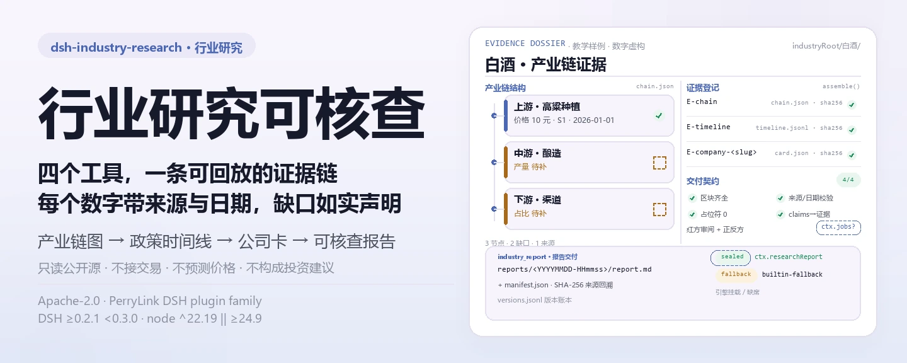

<div align="center">

<picture>
  <source media="(prefers-color-scheme: dark)" srcset="docs/assets/dsh-industry-research-hero-zh-dark.webp">
  
</picture>

# dsh-industry-research

**把一份行业研究做成可核查的证据链——每个数字带来源与日期，每个缺口如实声明。**

面向 DeepSeek Harness 的行业/公司研究领域包：四个工作区工具 + 两个方法论技能，只读公开源，只做研究支持。

[安装](#三步上手) · [配置](#配置) · [FAQ](#faq) · [简体中文](README.md) · [English](README.en.md) · [Español](README.es.md) · [Português](README.pt.md) · [हिन्दी](README.hi.md)

[](LICENSE)
[](#兼容性)
[](https://www.npmjs.com/package/dsh-industry-research)
[](https://github.com/PerryLink/dsh-industry-research/actions/workflows/ci.yml)
[](#兼容性)

[](https://github.com/PerryLink/dsh-industry-research/stargazers)
[](https://www.npmjs.com/package/dsh-industry-research)
[](https://dshfind.com/plugins/PerryLink/dsh-industry-research?ref=badge)
[](https://securityscorecards.dev/viewer/?uri=github.com/PerryLink/dsh-industry-research)
[](https://dsh.market/)
[](https://gitee.com/perrylink/dsh-industry-research)

```sh
dsh plugin --profile <name> add dsh-industry-research
```

</div>

<sub>社区插件，与 DeepSeek 官方无关。唯一仓库：<https://github.com/PerryLink/dsh-industry-research>（Gitee 为镜像）。</sub>

## 它是什么

`dsh-industry-research` 把行业研究拆成一条可回放的流水线：先建产业链结构图，再跟踪公开源政策与要闻，然后扫描公司出速览卡，最后组装成可核查报告。每个带值的指标必须带 `sourceRef`，每个缺口是显式槽位而不是编造的数字；报告要么交给封存引擎，要么走内置降级路径并如实标注。它只做研究支持：不接交易、不预测价格、不使用付费或需登录的数据源。

<picture>
  <source media="(prefers-color-scheme: dark)" srcset="docs/assets/dsh-industry-research-flow-v5-dark.svg">
  
</picture>

## 三步上手

1. **安装**（二选一，两条渠道都会把 bundle 行装入 profile 的 `dsh.profile.bundles` 栈，重启生效）：

   ```sh
   # git 通道（钉 commit；首次 add 会在 profile 的 pnpm-workspace.yaml 写入 allowBuilds 条目）
   dsh plugin --profile demo add "github:PerryLink/dsh-industry-research#<sha>"
   # npm 通道（已发布 0.3.25）
   dsh plugin --profile demo add dsh-industry-research
   ```

2. **最小配置**（默认即可用；只有要改产物目录或离线时才需要覆盖）：

   ```yaml
   - insert:
       - id: dsh-industry-research
         name: dsh-industry-research
         config:
           industryRoot: industry-research
           offline: false
   ```

3. **验证已生效**：

   ```sh
   dsh --profile demo --dump-config | grep dsh-industry-research
   ```

   然后在会话里按顺序调用工具：

   ```
   加载 industry-research-method 技能，然后研究白酒行业：
   先 industry_map 建产业链图，再 industry_track 跟踪政策，最后 industry_report 出报告。
   ```

**卸载**：`dsh plugin --profile demo remove dsh-industry-research`（或从 profile patch 删掉该行）。

<details>
<summary>从 DSH Desktop 市场安装</summary>

所有 PerryLink 插件均可在 DSH Desktop 内置市场中浏览：**市场 → 来源 → 添加来源 → 粘贴** `https://perrylink-dsh-catalog.perrylink.workers.dev/catalog-source.json` **→ 选中**。安装仍需通过市场的 npm 身份校验与你的确认。

</details>

## 核心能力

- **`industry_map`** —— 构建或更新产业链结构图（`chain.json`）：上/中/下游节点、边与指标槽位。带 `value` 的指标必须带 `sourceRef`；无值槽位即显式缺口。节点 `status` 断言必须带 `statusAsOf`，可选 `taxonomyCode` 必须命中内置国民经济行业分类大类表。`renderSvg: true` 时另写确定性的、按层级分层的 `chain.svg` 网络图并高亮漏斗/枢纽瓶颈。`depth` 调节 web 辅助规模。种子笔记/文件与可选 `ctx.web` 摘要登记为可引用来源（`S1`、`S2`……）。
- **`industry_track`** —— 经官方 `ctx.web` 缝隙跟踪公开源政策/要闻：按主题检索、来源主机白/黑名单、`since` 过滤、预算内快照抓取（SHA-256 溯源哈希），追加去重写入 `timeline.jsonl`（保留上限可配）。条目可带经校验的 `evidenceCategory`；`depth` 调节来源与抓取预算。web 能力不可达时响亮失败。
- **`company_scan`** —— 以工作区数据文件生成公司速览卡（`card.json` + `card.md`）：SHA-256 哈希、Markdown 大纲、数字候选行（每个数字可标注文件与行号），另可选 `ctx.web` 引用补充。卡片带上市状态（含 `statusAsOf`）、格式校验的 `ticker` 与带来源的价格/估值指标（各带 `source` + `asOf`）。批量模式（`companies`）隔离单个坏公司、不中断整批；`depth` 调节 web 补充规模。v1 只读文本格式（不解析 PDF）。
- **`industry_report`** —— 汇总结构图、时间线与公司卡产出可核查报告。产出前跑确定性交付契约校验（区块、状态/价格断言、占位符残留；不通过即响亮失败，绝不交付半成品）。时间线条目按 `evidenceCategory` 分组。确定性正反方（bull/bear）合成把「有来源且带日期的数值」列为多方、「缺口与数据质量发现」列为空方，嵌入报告多视角小节，并派生 subagent job 写回 `perspectives-note.md` 入账本。挂载 `ctx.researchReport` 引擎时证据/章节/claims 提交其 `assemble` 封存并回传逐 claim 结论；缺席时内置降级路径写入版本化 `reports/<YYYYMMDD-HHmmss>/report.md` + `manifest.json`（含 SHA-256 来源回溯表），并如实标注 `engine: 'builtin-fallback'`。
- **产物版本账本** —— `industry_map` / `company_scan` / `industry_report` 每次落盘都向 `versions.jsonl` 追加一条（根相对路径 + SHA-256 + 时间戳 + 变更类型）；读取时校验哈希，不一致即响亮失败。
- **两个方法论技能** —— `industry-research-method`（产业链拆分、供需框架、口径纪律、缺口声明纪律）与 `company-research-method`（公司研究框架、公开源清单、合规话术）。
- **类型化 Cordis 事件** —— 每份产物落盘后发出 `industry-research/map`、`industry-research/track`、`industry-research/report`。

两个方法论技能经标准 `skill` 工具按需加载（`加载 industry-research-method 技能`）。

### 工具面

#### `industry_map({ industry, seed?, seedFiles?, web?, chain?, renderSvg?, depth? })`

带 `chain` 调用：校验（悬空边、无来源数值、非法 tier、重复 id、status/statusAsOf、未知 `taxonomyCode`——带完整问题清单响亮失败）并落盘 `chain.json`，随后列出显式缺口槽位与瓶颈节点。不带 `chain` 调用：返回当前图、已登记来源与可选 `ctx.web` 产业链结构摘要，供模型迭代。`renderSvg: true` 时另写确定性的 `chain.svg`。`depth`（quick/standard/comprehensive）调节 web 辅助检索规模。返回与上次 `research-state.json` 相比的 `delta` 摘要。发出 `industry-research/map` 事件。

#### `industry_track({ industry, topics?, since?, depth?, evidenceCategory? })`

经 `ctx.web` 逐主题检索，按白/黑名单与 `since` 过滤，在调用预算内抓取页面快照（SHA-256），合并进 `timeline.jsonl`（按规范化 URL 去重，保留上限）。`depth` 调节来源/抓取预算；`evidenceCategory` 为本批条目打分类标签并按六类枚举校验。快照失败的来源以纯引用条目保留并在 `note` 中说明原因。返回与上次 `research-state.json` 相比的 `delta` 摘要。`ctx.web` 未挂载或 `offline: true` 时响亮失败并指明缺失能力。发出 `industry-research/track` 事件。

#### `company_scan({ name | companies, dataFiles?, web?, status?, statusAsOf?, ticker?, metrics?, depth?, parallel? })`

读取工作区数据文件（`.md/.txt/.csv/.tsv/.json`；v1 不解析 PDF），计算哈希，提取 Markdown 大纲与数字候选行，可选附加 `ctx.web` 引用，落盘速览卡。`status` 必须带非未来 `statusAsOf`；`ticker` 必须匹配内置格式（除非 `scan.strictTicker: false`）；每条 `metrics` 数值必须带 `source` + `asOf`。`companies`（批量）单公司失败不中断整批；`parallel: true` 且挂载 `ctx.jobs` 时按公司 fan-out 为独立 job（否则回退顺序路径并在结果 `mode` 注明）。未采纳文件带原因返回；卡片无法确立的内容一律写入显式缺口。

#### `industry_report({ industry, sections?, companies?, draft? })`

组装证据（`E-chain`、`E-timeline`、`E-company-<slug>`），读取时对照 `versions.jsonl` 校验哈希（不一致响亮失败），或校验你提供的 `draft`（章节 + claims；每条 claim 的 `evidenceIds` 必须引用已登记证据），或机械自动生成草稿（有来源的指标与近期时间线条目生成 claims，按 `evidenceCategory` 分组）。产出前跑确定性交付契约校验（缺区块/占位符/无来源或无日期断言即响亮失败）。确定性对抗机器检查始终执行；挂载 `ctx.jobs` 时派生红方审阅 job 写回 `red-review-note.md`（否则 `review: skipped(jobs unavailable)`）。确定性正反方（bull/bear）合成嵌入报告多视角小节，挂载 `ctx.jobs` 时派生辩论 job 写回 `perspectives-note.md`。引擎路径：封存目录 + `sealHash` + 逐 claim 结论。降级路径：版本化 Markdown + manifest，claims 如实标记 `unverified`。发出 `industry-research/report` 事件。

### 示例

以下为插件真实入口；安装后调用一个即可。

**详细示例** —— 命令 `industry_map`，输入：

~~~sh
industry_map({
  industry: "示例",
  web: false,
  chain: {
    nodes: [
      { id: "up", name: "上游原料", tier: "upstream", metrics: [{ key: "价格", value: 10, unit: "元", asOf: "2026-01-01", sourceRef: "S1" }] },
      { id: "down", name: "下游渠道", tier: "downstream", metrics: [{ key: "占比" }] }
    ],
    edges: [{ from: "up", to: "down" }]
  }
})
~~~

输出：

~~~text
行业「示例」产业链图：已校验并写入 /tmp/dsh-industry-research-test-Pxf1l8/industry-research/示例/chain.json
节点 2 / 边 1；缺口 2 项。
与上次相比：新增源 0，移除源 0，未变化证据 0。
缺口清单：节点「下游渠道」(down) 的指标「占比」待补（无来源数值）；产业链缺少 midstream 层节点
web 辅助未执行：调用方指定 web: false
~~~

*Observed from `README.md:151-153; test/map.spec.ts:44-51; src/tools/map.ts:157-163; src/chain.ts:177-194`*

**失败分支** —— 输入：

~~~text
{"industry":"白酒","web":false,"chain":{"industry":"白酒","nodes":[{"id":"upstream-1","name":"高粱种植","tier":"upstream","metrics":[{"key":"市场规模","value":120,"unit":"亿元"}]}],"edges":[]}}
~~~

输出：

~~~text
isError=true; error.message=chain 校验失败（1 项）：node "upstream-1" metric "市场规模" carries a value without a sourceRef — register the source or mark the slot 待补 (omit value)
~~~

*Observed from `plugins/dsh-industry-research/src/chain.ts:158-159 (rule); plugins/dsh-industry-research/src/tools/map.ts:232-234 (throw); plugins/dsh-industry-research/README.md:179 (unsourced values fail loud); exercised through plugins/dsh-industry-research/test/harness.ts`*

**简短示例**：`industry_track` · `company_scan` · `industry_report`

### 数据布局

```
<工作区>/<industryRoot>/versions.jsonl              工件版本清单（SHA-256 + 时间戳 + 变更类型）
<工作区>/<industryRoot>/<行业>/research-state.json  研究状态记忆
<工作区>/<industryRoot>/<行业>/chain.json           industry_map
<工作区>/<industryRoot>/<行业>/chain.svg            industry_map（renderSvg: true）
<工作区>/<industryRoot>/<行业>/timeline.jsonl       industry_track
<工作区>/<industryRoot>/<行业>/sources.json         可引用来源登记（S1、S2……）
<工作区>/<industryRoot>/<行业>/notes/               种子笔记
<工作区>/<industryRoot>/<行业>/red-review-note.md   industry_report（红方审阅，需 jobs）
<工作区>/<industryRoot>/<行业>/perspectives-note.md industry_report（正反方辩论，需 jobs）
<工作区>/<industryRoot>/<行业>/reports/<ts>/        industry_report（report.md + manifest.json）
<工作区>/<industryRoot>/companies/<公司>/card.*     company_scan
```

## 配置

全部可调项均为 Schemastery `Config` 字段（可从 cordis.yml 覆盖）；非法值在加载期响亮失败。按 id 覆盖会替换整行——请重述所有需要的键。`cordis.patch.yml` 逐键内联注释。

最常用键：

| 键 | 默认值 | 含义 |
|---|---|---|
| `enabled` | `true` | 总开关；`false` 不挂载任何能力。 |
| `industryRoot` | `industry-research` | 产物根目录（相对会话工作区，或绝对路径）。 |
| `fetchTimeoutMs` | `20000` | `ctx.web` 检索/抓取的单次请求超时（毫秒）。 |
| `timelineMaxEntries` | `500` | 每个行业 `timeline.jsonl` 的保留条数（最旧先弃）。 |
| `sourceAllowlist` | `[]` | 跟踪来源主机白名单（空 = 全部允许）。 |
| `sourceBlocklist` | `[]` | 跟踪来源主机黑名单（优先于白名单）。 |
| `offline` | `false` | 离线模式：不触网，只用本地工作区数据。 |
| `skillsDir` | _(未设置)_ | 显式 skills 根目录覆盖；缺省用随包 `skills/`。 |

<details>
<summary>完整配置表（13 个键）</summary>

| 键 | 默认值 | 含义 |
|---|---|---|
| `enabled` | `true` | 总开关；`false` 不挂载任何能力。 |
| `industryRoot` | `industry-research` | 产物根目录（相对会话工作区，或绝对路径）。 |
| `fetchTimeoutMs` | `20000` | `ctx.web` 检索/抓取的单次请求超时（毫秒）。 |
| `timelineMaxEntries` | `500` | 每个行业 `timeline.jsonl` 的保留条数（最旧先弃）。 |
| `sourceAllowlist` | `[]` | 跟踪来源主机白名单（空 = 全部允许）。 |
| `sourceBlocklist` | `[]` | 跟踪来源主机黑名单（优先于白名单）。 |
| `offline` | `false` | 离线模式：不触网，只用本地工作区数据。 |
| `skillsDir` | _(未设置)_ | 显式 skills 根目录覆盖；缺省用随包 `skills/`。 |
| `track.maxResultsPerTopic` | `10` | 每个主题的 `web_search` maxResults。 |
| `track.maxFetchesPerCall` | `10` | 每次 `industry_track` 调用的快照抓取预算。 |
| `scan.maxFileBytes` | `1048576` | 公司数据文件的单文件读取上限（字节）。 |
| `scan.maxFigureCandidates` | `100` | 每次公司扫描的数字候选行预算。 |
| `scan.strictTicker` | `true` | 公司卡 ticker 必须匹配内置格式（A 股 6 位数字、美股 1–5 字母、港股 1–5 数字）；`false` 豁免格式校验。 |

</details>

profile patch 覆盖示例：

```yaml
- insert:
    - id: dsh-industry-research
      name: dsh-industry-research
      config:
        industryRoot: industry-research
        offline: false
        track:
          maxFetchesPerCall: 5
        scan:
          strictTicker: false
```

## FAQ

<details>
<summary>数据存在哪？会不会传出去？</summary>

产物全部写在会话工作区的 `<industryRoot>/` 下（默认 `industry-research/`）：`chain.json`、`timeline.jsonl`、`sources.json`、`reports/<ts>/`、公司卡与 `versions.jsonl` 版本账本。插件自身不发起网络请求、不存凭据；一切检索经 `ctx.web`，provider 选择与超时由部署方与你的配置决定。付费或需登录的数据源不在范围内——请自行导出后作为 `dataFiles` 传入。

</details>

<details>
<summary>没挂 `ctx.web` 或 `ctx.researchReport` 会怎样？会静默失效吗？</summary>

不会静默。缺少 `ctx.web` 时 `industry_track` 响亮失败并点名缺失能力；缺少 `ctx.researchReport` 时 `industry_report` 走内置降级路径，写版本化 `report.md` + `manifest.json` 并如实标注 `engine: 'builtin-fallback'`，claims 标记 `unverified`。没挂 `ctx.jobs` 时 `parallel: true` 顺序降级，红方审阅与正反方辩论分别记为 `skipped(jobs unavailable)`。

</details>

<details>
<summary>会和其他插件冲突吗？</summary>

不会。只注入 `skills` 与 `tools`，不注册 waterfall 监听器、命令、客户端 slot 或 `webServer` 路由；`ctx.web` / `ctx.researchReport` / `ctx.jobs` 用 `ctx.get(...)` 在运行时查找而不是写进 `inject`，所以缺兄弟插件时不会把插件树停在 PENDING。逐条依据见「互操作性」。

</details>

<details>
<summary>性能开销多大？</summary>

全是本地确定性计算：读写 Markdown/JSON、算 SHA-256、校验结构，不调用模型。联网只发生在 `industry_track`（以及 `industry_map` / `company_scan` 的 web 辅助）里，且被 `track.maxFetchesPerCall`、`track.maxResultsPerTopic` 与 `fetchTimeoutMs` 限定为前台预算；`offline: true` 可完全关掉联网。

</details>

<details>
<summary>能直接读 PDF 吗？</summary>

不能。v1 只读文本格式（`.md/.txt/.csv/.tsv/.json`），不解析 PDF。请先把 PDF 转成文本或 Markdown，再作为 `dataFiles` 传入。

</details>

## 安全边界

- **工作区隔离** —— 行业/公司名校验为单一路径段；数据文件对照会话 cwd 做包含性检查（双侧 resolve）。
- **构造即溯源** —— 来源带 SHA-256 哈希；无来源数字即校验错误；损坏时间线行跳过且计数如实上报，绝不静默。
- **诚实降级** —— 缺少 `ctx.web` / `ctx.researchReport` 时响亮失败或产出如实标注的降级产物，绝不静默编造。
- **可逆注册** —— 一切贡献经 `ctx.effect()` / `ctx.on()` / `register()`。
- **纯研究合规** —— 工具描述、卡片与报告均带「仅供研究，不构成投资建议」；数据点带 asOf 与来源。

## 已知限制

- **Cordis 事件而非会话日志事件** —— `industry-research/*` 事件是类型化 Cordis 可观测性事件，绝不追加进会话日志；持久记录是工作区产物本身；模型可见的工具结果走持久 `tool/result` 会话事件。
- **不写 `ctx.attachment`** —— rc2 附件缝隙只接受图片（PNG/JPEG/WebP/GIF）；Markdown 报告因此保持为版本化工作区文件，工具结果中以绝对路径引用。
- **v1 只读文本格式** —— 不解析 PDF；请用户先把 PDF 转成文本/Markdown。
- **中文版技能** —— 随包方法论技能为中文版；英文版为后续工作。
- **前台工具** —— `industry_track` 由 `track.maxFetchesPerCall` 与 `fetchTimeoutMs` 界定为前台任务；后台任务模式为后续工作。
- **自动草稿是机械组装** —— 它汇总产物并把有来源的数据点生成 claims；叙述质量来自模型撰写的 `draft`。

## 互操作性

本插件只消费公开缝隙，不接管任何共享资源：

- **只注入两个服务** —— `inject = ['skills', 'tools']`；`ctx.web`、`ctx.researchReport`、`ctx.jobs` 全是执行期 `ctx.get(...)` 结构查找（带形状守卫），缺任何一个都不会让插件停在 PENDING。
- **不注册监听器** —— 没有任何 waterfall 监听器，也不监听 `agent/pre-step`、`tools/post-execute` 等共享事件，因此不存在短路或饿死其他插件的可能。
- **不抢共享命名** —— 不注册命令、客户端 slot 或 `webServer` 前缀；四个工具名（`industry_map`、`industry_track`、`company_scan`、`industry_report`）均带命名空间，不占裸名。
- **skills 走独立 provider** —— 以 `industry-research` 为名、`includeDefaultRoots: false` 挂载，不接管也不替换全局 skills 根；`skillsDir` 非法时加载期响亮失败。
- **patch 只 insert 自己** —— 组合包 patch 只插入自己那一行，从不覆写内置行的 `config`。
- **与 `dsh-research-report` 的契约在类型侧** —— `AssembleReportRequest` 等以 type-only devDependency 引入、构建时擦除，运行时只经 `ctx.get('researchReport')` 查找；未挂载时走内置降级，绝不静默编造封存结果。
- **与 `dsh-base`** —— `ctx.web` 由 base bundle 组合；缺失时 `industry_track` 响亮失败并给出挂载指引。
- **持续体检** —— `.github/workflows/plugin-doctor.yml` 跑插件体检；结论以工作流输出为准。

## 权限与数据

`dsh-industry-research` 只消费公开缝隙：`ctx.tools`、`ctx.skills`，以及可选查找的 `ctx.web` 与 `ctx.researchReport`。本插件自身不发起任何网络访问（一切检索经 `ctx.web`，provider 选择与超时由部署方与你的配置决定），不存凭据，只在会话工作区的 `industryRoot` 下写文件。只使用公开源；付费或需登录的数据源不在范围内——请自行导出后作为 `dataFiles` 传入。

## 兼容性

| 维度 | 状态 |
|---|---|
| Harness | DeepSeek Harness `dsh-v0.2.1-alpha.1`（npm 发布线，2026-09-25 已核验）；`package.json` 的 `engine.dsh` 声明 `>=0.2.1-0 <0.3.0 \|\| >=0.2.2-0 <0.3.0`。0.1.2-rc.1（2026-09-02 已适配）：会话信封保留 ignorable 字段但仅用于存量日志读取兼容——Session.append 仍无法盖章，门控行为不变。2026-09-24 已对照 `0.1.7-rc.2` 已发布 peer 实测（完整门禁链；真实 profile 安装冒烟由每周及每 PR 的 `compat.yml` 执行）。 |
| Node | `^22.19.0 \|\| >=24.9.0`，仅 ESM（`"type": "module"`）。 |
| Peer 依赖 | `@deepseek-ai/cordis ^4.0.5-alpha.1`、`@deepseek-ai/schemastery ^3.18.5-alpha.1`，以及 `@deepseek-ai/dsh-tools`、`@deepseek-ai/dsh-skill`、`@deepseek-ai/dsh-skill-filesystem`（peer 范围 `>=0.1.2-rc.1 <0.2.0 \|\| >=0.1.5-alpha.1 <0.2.0 \|\| >=0.1.6-0 <0.2.0 \|\| >=0.1.7-0 <0.2.0 \|\| >=0.2.0-0 <0.3.0 \|\| >=0.2.1-0 <0.3.0 \|\| >=0.2.2-0 <0.3.0`，官方 `dsh-base` bundle 均已组合）。 |
| 平台 | 任何 DSH 可运行处；工具是纯主机端 TypeScript，无浏览器半。 |
| 可选能力 | 执行时查找（绝不注入）：`ctx.web`（公开源检索，`dsh-base` 已组合）与 `ctx.researchReport`（兄弟插件 `dsh-research-report` 的封存引擎）。 |

## 生态与质量

- [Gitee 镜像](https://gitee.com/perrylink/dsh-industry-research)（同步镜像，以 GitHub 为准）
- [dshfind 插件页](https://dshfind.com/plugins/PerryLink/dsh-industry-research)（安装量与排名）
- [OpenSSF Scorecard 报告](https://securityscorecards.dev/viewer/?uri=github.com/PerryLink/dsh-industry-research)（由 [.github/workflows/scorecard.yml](.github/workflows/scorecard.yml) 驱动）
- [dsh-plugin-doctor 验证报告](https://github.com/PerryLink/dsh-plugin-doctor#verified-徽章)
- [DSH Market](https://dsh.market/)（已上架）
- **1024 商店渠道**：先 `npm i -g dsh1024`，再 `dsh1024 plugin --profile web add dsh-industry-research`（计入 [deepseek1024.com](https://deepseek1024.com) 安装排行）
- [生态实测知识库](https://perrylink.github.io/dsh-plugin-guide/)（实测数据，不是营销）：插件开发指南 · 选型实测数据 · 维护取舍判据

## 开发

```sh
pnpm install
pnpm run typecheck && pnpm run typecheck:ci     # 已发布 peer 面 + 清空 skipLibCheck 的发布线面
pnpm test                                       # vitest
pnpm run build                                  # scripts/prepare.mjs → lib/
pnpm run verify:self-contained && pnpm run verify:artifacts
pnpm run verify:readme-sync                     # 五语 README 结构与配置键一致性
pnpm run verify:skills                          # skills frontmatter 门禁
pnpm run pack:check
```

配图由 [`scripts/gen-readme-assets.py`](scripts/gen-readme-assets.py) 程序化生成（Python + Pillow），可重复执行：`python scripts/gen-readme-assets.py`。深浅两版 SVG 都在 `docs/assets/`，图内只放命令与产物 token，五语共用。

| 路径 | 内容 |
|---|---|
| `src/` | 函数式插件入口（`index.ts`）、`config.ts`、四个工具与纯数据模型 |
| `skills/` | 两个中文版方法论技能（`SKILL.md` 包） |
| `cordis.patch.yml` | bundle 行声明，逐键内联注释 |
| `test/` | vitest 套件（真实 Context / ToolRuntime / SkillRegistry / WebRuntime） |
| `fixtures/` | 白酒行业教学样例（虚构，明确标注） |
| `scripts/` | 构建与门禁：`prepare.mjs`、`verify-*`、`check-readme-sync.mjs`、`check-skills.mjs` |
| `docs/assets/` | README 配图（本脚本生成） |
| `.github/workflows/` | CI、compat、plugin-doctor、release、scorecard |

Topics：`dsh`、`dsh-plugin`、`deepseek-harness`、`cordis`、`industry-research`、`company-research`、`research`、`report`

## 家族与致谢

本项目是 [PerryLink](https://github.com/PerryLink) 维护的 DeepSeek Harness 插件家族成员（全部 Apache-2.0）。如果这个插件帮到了你，**给个 star**——它不解锁任何功能，但会让下一个人更容易找到它。

- 初始设计与实现：`dsh-industry-research` 开发会话（DeepSeek Harness）。
- 欢迎外部贡献——提交 issue 或 pull request。

<details>
<summary>展开全部插件</summary>

| 插件 | 状态 |
|---|---|
| **[dsh-aqua-input-check](https://github.com/PerryLink/dsh-aqua-input-check)** |  |
| **[dsh-archive-check](https://github.com/PerryLink/dsh-archive-check)** |  |
| **[dsh-auto-review](https://github.com/PerryLink/dsh-auto-review)** |  |
| **[dsh-autotier](https://github.com/PerryLink/dsh-autotier)** | 🧊 已冻结 — 见仓库 README |
| **[dsh-bid-ca-precheck](https://github.com/PerryLink/dsh-bid-ca-precheck)** |  |
| **[dsh-bid-qual-check](https://github.com/PerryLink/dsh-bid-qual-check)** |  |
| **[dsh-cert-mcp](https://github.com/PerryLink/dsh-cert-mcp)** | 🧊 已冻结 — 见仓库 README |
| **[dsh-checkpoint-rewind](https://github.com/PerryLink/dsh-checkpoint-rewind)** |  |
| **[dsh-click](https://github.com/PerryLink/dsh-click)** |  |
| **[dsh-composer-history](https://github.com/PerryLink/dsh-composer-history)** |  |
| **[dsh-contract-stance](https://github.com/PerryLink/dsh-contract-stance)** |  |
| **[dsh-customs-doc-check](https://github.com/PerryLink/dsh-customs-doc-check)** |  |
| **[dsh-data-quality](https://github.com/PerryLink/dsh-data-quality)** | 🧊 已冻结 — 见仓库 README |
| **[dsh-demurrage-ledger](https://github.com/PerryLink/dsh-demurrage-ledger)** |  |
| **[dsh-doublecheck](https://github.com/PerryLink/dsh-doublecheck)** |  |
| **[dsh-drill-script-check](https://github.com/PerryLink/dsh-drill-script-check)** |  |
| **[dsh-eia-guide-check](https://github.com/PerryLink/dsh-eia-guide-check)** |  |
| **[dsh-emergency-plan](https://github.com/PerryLink/dsh-emergency-plan)** |  |
| **[dsh-essay-rubric-check](https://github.com/PerryLink/dsh-essay-rubric-check)** |  |
| **[dsh-evidence-check](https://github.com/PerryLink/dsh-evidence-check)** |  |
| **[dsh-export-ctl-check](https://github.com/PerryLink/dsh-export-ctl-check)** |  |
| **[dsh-fast](https://github.com/PerryLink/dsh-fast)** |  |
| **[dsh-fmea-table-check](https://github.com/PerryLink/dsh-fmea-table-check)** |  |
| **[dsh-forecast-penalty](https://github.com/PerryLink/dsh-forecast-penalty)** |  |
| **[dsh-fund-research](https://github.com/PerryLink/dsh-fund-research)** |  |
| **[dsh-github](https://github.com/PerryLink/dsh-github)** |  |
| **[dsh-gongwen-flow-check](https://github.com/PerryLink/dsh-gongwen-flow-check)** |  |
| **[dsh-gongwen-word-check](https://github.com/PerryLink/dsh-gongwen-word-check)** |  |
| **[dsh-guard-plan-qc](https://github.com/PerryLink/dsh-guard-plan-qc)** |  |
| **[dsh-hazchem-check](https://github.com/PerryLink/dsh-hazchem-check)** |  |
| **[dsh-hazplan-check](https://github.com/PerryLink/dsh-hazplan-check)** |  |
| **[dsh-hidden-risk-map](https://github.com/PerryLink/dsh-hidden-risk-map)** |  |
| **[dsh-hs-classify](https://github.com/PerryLink/dsh-hs-classify)** |  |
| **[dsh-icd-rule-check](https://github.com/PerryLink/dsh-icd-rule-check)** |  |
| **[dsh-industry-research](https://github.com/PerryLink/dsh-industry-research)** |  |
| **[dsh-lawcite-adapter](https://github.com/PerryLink/dsh-lawcite-adapter)** |  |
| **[dsh-laya](https://github.com/PerryLink/dsh-laya)** |  |
| **[dsh-lc-doc-check](https://github.com/PerryLink/dsh-lc-doc-check)** |  |
| **[dsh-learning-gap-check](https://github.com/PerryLink/dsh-learning-gap-check)** |  |
| **[dsh-library](https://github.com/PerryLink/dsh-library)** |  |
| **[dsh-local-ai](https://github.com/PerryLink/dsh-local-ai)** |  |
| **[dsh-lsp-actions](https://github.com/PerryLink/dsh-lsp-actions)** |  |
| **[dsh-mask](https://github.com/PerryLink/dsh-mask)** |  |
| **[dsh-mcp-panel](https://github.com/PerryLink/dsh-mcp-panel)** |  |
| **[dsh-medrec-qc](https://github.com/PerryLink/dsh-medrec-qc)** |  |
| **[dsh-memento](https://github.com/PerryLink/dsh-memento)** | 🧊 已冻结 — 见仓库 README |
| **[dsh-nsfc-form-check](https://github.com/PerryLink/dsh-nsfc-form-check)** |  |
| **[dsh-nurse-record-check](https://github.com/PerryLink/dsh-nurse-record-check)** |  |
| **[dsh-observe](https://github.com/PerryLink/dsh-observe)** |  |
| **[dsh-origin-rvc-check](https://github.com/PerryLink/dsh-origin-rvc-check)** |  |
| **[dsh-ota-review-check](https://github.com/PerryLink/dsh-ota-review-check)** |  |
| **[dsh-output-styles](https://github.com/PerryLink/dsh-output-styles)** |  |
| **[dsh-paper-doc-adapter](https://github.com/PerryLink/dsh-paper-doc-adapter)** |  |
| **[dsh-permission-rules](https://github.com/PerryLink/dsh-permission-rules)** |  |
| **[dsh-permit-report-check](https://github.com/PerryLink/dsh-permit-report-check)** |  |
| **[dsh-pipeline-check](https://github.com/PerryLink/dsh-pipeline-check)** |  |
| **[dsh-pleading-draft](https://github.com/PerryLink/dsh-pleading-draft)** |  |
| **[dsh-plugin-doctor](https://github.com/PerryLink/dsh-plugin-doctor)** | 🚫 已退役（仓库已归档） |
| **[dsh-plugin-guide](https://github.com/PerryLink/dsh-plugin-guide)** |  |
| **[dsh-plugin-kit](https://github.com/PerryLink/dsh-plugin-kit)** | 🚫 已退役（仓库已归档） |
| **[dsh-plugin-upgrade](https://github.com/PerryLink/dsh-plugin-upgrade)** | 🚫 已退役（仓库已归档） |
| **[dsh-policy-brief-draft](https://github.com/PerryLink/dsh-policy-brief-draft)** |  |
| **[dsh-power-loss-split](https://github.com/PerryLink/dsh-power-loss-split)** |  |
| **[dsh-power-ticket-check](https://github.com/PerryLink/dsh-power-ticket-check)** |  |
| **[dsh-ppap-check](https://github.com/PerryLink/dsh-ppap-check)** |  |
| **[dsh-protest-deadline](https://github.com/PerryLink/dsh-protest-deadline)** |  |
| **[dsh-railway-window](https://github.com/PerryLink/dsh-railway-window)** |  |
| **[dsh-repair-order-qc](https://github.com/PerryLink/dsh-repair-order-qc)** |  |
| **[dsh-research-report](https://github.com/PerryLink/dsh-research-report)** |  |
| **[dsh-review-reply-check](https://github.com/PerryLink/dsh-review-reply-check)** |  |
| **[dsh-rulefile-check](https://github.com/PerryLink/dsh-rulefile-check)** |  |
| **[dsh-safety-brief-check](https://github.com/PerryLink/dsh-safety-brief-check)** |  |
| **[dsh-score](https://github.com/PerryLink/dsh-score)** | 🧊 已冻结 — 见仓库 README |
| **[dsh-session-sync](https://github.com/PerryLink/dsh-session-sync)** |  |
| **[dsh-site-log-check](https://github.com/PerryLink/dsh-site-log-check)** |  |
| **[dsh-skill-pack-security](https://github.com/PerryLink/dsh-skill-pack-security)** |  |
| **[dsh-soe-decision-check](https://github.com/PerryLink/dsh-soe-decision-check)** |  |
| **[dsh-soilwater-check](https://github.com/PerryLink/dsh-soilwater-check)** |  |
| **[dsh-sop-sync-check](https://github.com/PerryLink/dsh-sop-sync-check)** |  |
| **[dsh-spc-gbt-adapter](https://github.com/PerryLink/dsh-spc-gbt-adapter)** |  |
| **[dsh-talk](https://github.com/PerryLink/dsh-talk)** |  |
| **[dsh-tender-extract](https://github.com/PerryLink/dsh-tender-extract)** |  |
| **[dsh-tender-matrix](https://github.com/PerryLink/dsh-tender-matrix)** |  |
| **[dsh-test-drive](https://github.com/PerryLink/dsh-test-drive)** |  |
| **[dsh-ticktick](https://github.com/PerryLink/dsh-ticktick)** | 🚫 已退役（仓库已归档） |
| **[dsh-translate](https://github.com/PerryLink/dsh-translate)** |  |
| **[dsh-warranty-calc](https://github.com/PerryLink/dsh-warranty-calc)** |  |
| **[dsh-budget](https://github.com/PerryLink/dsh-budget)** | 🧊 已冻结 — 见仓库 README |
| **[dsh-claude-move](https://github.com/PerryLink/dsh-claude-move)** | 🧊 已冻结 — 见仓库 README |
| **[dsh-defend](https://github.com/PerryLink/dsh-defend)** | 🧊 已冻结 — 见仓库 README |
| **[dsh-draw](https://github.com/PerryLink/dsh-draw)** | 🧊 已冻结 — 见仓库 README |
| **[dsh-reach](https://github.com/PerryLink/dsh-reach)** | 🧊 已冻结 — 见仓库 README |
| **[dsh-background-agents](https://github.com/PerryLink/dsh-background-agents)** | 🚫 已退役（仓库已归档） |
| **[dsh-session-pin](https://github.com/PerryLink/dsh-session-pin)** | 🚫 已退役（仓库已归档） |
| **[dsh-team-rooms](https://github.com/PerryLink/dsh-team-rooms)** | 🚫 已退役（仓库已归档） |

</details>

## License

Apache-2.0 —— 见 [LICENSE](LICENSE)。

<p align="center"><sub>Apache-2.0 · 社区插件，与 DeepSeek 无关。</sub></p>
